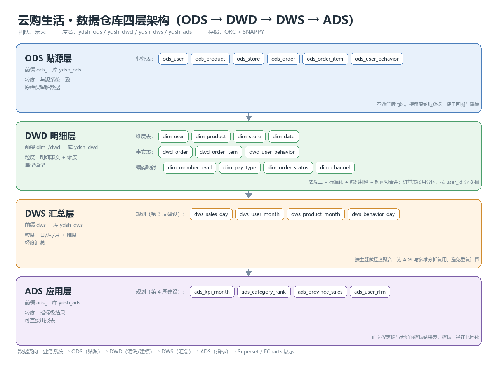
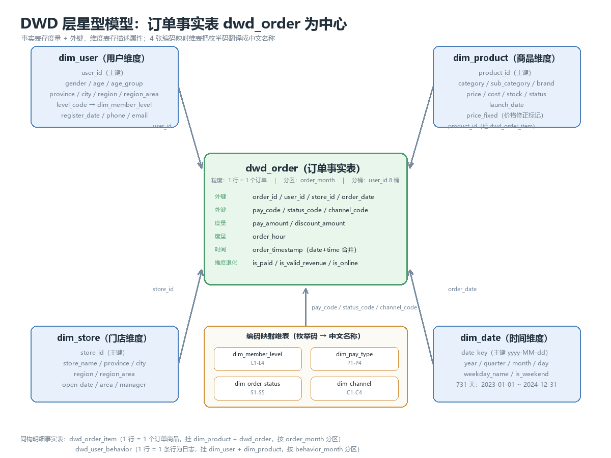
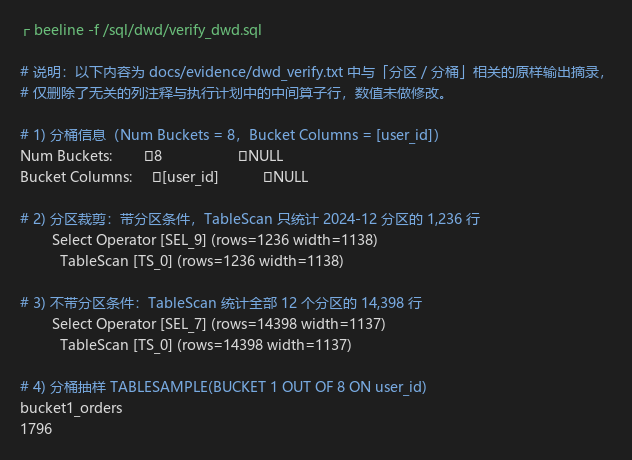

# 云购生活 · 数据仓库架构设计文档（第 2 周）

| 项目 | 内容 |
|---|---|
| 项目名称 | 云购生活新零售企业 · 企业级数据仓库与经营分析可视化系统 |
| 团队 | 乐天（余天乐，20230308098） |
| 文档版本 | v2.0（第 2 周） |
| 编写日期 | 2026-11-02 |
| 依据 | 《第 2 周任务书》子任务 5：Hive 四层数仓架构设计 |

---

## 一、设计目标与原则

### 1.1 目标

1. 把 6 张业务系统的原始表（11.48 万行）组织成**可分层、可复用、可追溯**的数据仓库；
2. 让"清洗 → 建模 → 汇总 → 指标"四件事各归其位，任何一层出问题都能定位到上游；
3. 用 Hive 的分区表 / 分桶表解决 11 万行以上的查询扫描问题，为第 3～4 周的 DWS/ADS 和可视化预留性能空间。

### 1.2 设计原则

| 原则 | 说明 | 本项目的落地方式 |
|---|---|---|
| 分层解耦 | 每层只依赖上一层，不跨层取数 | ODS 只读 CSV 导入；DWD 只读 ODS；DWS 只读 DWD；ADS 只读 DWS/DWD |
| 命名可读 | 看表名就知道属于哪一层、什么粒度 | 前缀 `ods_` / `dwd_` / `dim_` / `dws_` / `ads_`，库名 `ydsh_*` |
| 原样贴源 | ODS 层不做任何加工，脏数据保留 | `ods_*` 6 张表与 CSV 字段一一对应，连"脏"一起导入 |
| 单一事实来源 | 同一指标只在一个地方定义 | GMV、客单价口径固化在 DWD 层字段（`is_valid_revenue`）与本文第五节 |
| 保留处理痕迹 | 清洗动作必须可回溯 | 维度表保留 `*_fixed` / `*_missing` / `*_filled` 标记位 |
| 可重跑 | 脚本幂等，重跑结果一致 | 全部使用 `insert overwrite` + `drop table if exists`，不用 UPDATE/DELETE |

---

## 二、四层架构总览



**数据流向**：业务系统 CSV → ODS（贴源）→ DWD（清洗/建模）→ DWS（汇总）→ ADS（指标）→ Superset / ECharts 展示。

| 分层 | 库名 | 表名前缀 | 定位 | 数据粒度 | 存储 | 本周状态 |
|---|---|---|---|---|---|---|
| ODS 贴源层 | `ydsh_ods` | `ods_` | 原样接入业务数据，保留全部脏数据 | 与源系统一致，最细粒度 | 文本表（TEXTFILE，逗号分隔） | ✅ 已完成（第 1 周） |
| DWD 明细层 | `ydsh_dwd` | `dim_` / `dwd_` | 清洗、标准化、编码翻译、维度关联 | 明细事实 + 维度（星型模型） | ORC + SNAPPY | ✅ 本周完成 |
| DWS 汇总层 | `ydsh_dws` | `dws_` | 按主题轻度汇总，供多场景复用 | 日 / 周 / 月 + 维度 | ORC + SNAPPY | ⏳ 第 3 周建设（已规划） |
| ADS 应用层 | `ydsh_ads` | `ads_` | 面向指标与报表，直接供可视化 | 指标级结果（一行一指标） | ORC + SNAPPY | ⏳ 第 4 周建设（已规划） |

> 为什么 ODS 用文本表而 DWD 用 ORC：ODS 要"看到原始样子"，文本表最直观、便于核对；DWD 是真正被查询的层，ORC 列式存储 + SNAPPY 压缩后 `dwd_order` 12 个分区合计仅 933 KB（`describe formatted` 的 `totalSize`），而原始 CSV 为 1.38 MB。

---

## 三、各层职责与库表清单

### 3.1 ODS 层（ydsh_ods，6 张表）

| 表名 | 行数 | 说明 |
|---|---|---|
| `ods_user` | 1,000 | 用户信息，含性别/等级/日期/手机号格式问题 |
| `ods_product` | 600 | 商品信息，含负价格、超大价格、缺失上架日期 |
| `ods_store` | 60 | 门店信息，本身干净 |
| `ods_order` | 15,600 | 订单主表，含 600 条重复 |
| `ods_order_item` | 37,549 | 订单明细，含数量/单价异常 |
| `ods_user_behavior` | 60,000 | 行为日志，含时间格式与行为类型不规范 |

附带说明：第 1 周清洗一（缺失值、重复值）的产物 `dwd_user` / `dwd_product` / `dwd_order` 也落在 `ydsh_ods` 库中，作为**清洗一阶段的临时结果**保留，本周清洗二以它们为输入（链路见 3.2）。

### 3.2 DWD 层（ydsh_dwd，25 张表 = 11 张正式表 + 14 张清洗中间表）

**维度表（4 张，存描述属性）**

| 表名 | 行数 | 主键 | 说明 |
|---|---|---|---|
| `dim_user` | 1,000 | `user_id` | 用户维度：性别/年龄/年龄段/省市区/大区/会员等级编码 |
| `dim_product` | 600 | `product_id` | 商品维度：类目/品牌/价格/库存/上架日期 |
| `dim_store` | 60 | `store_id` | 门店维度：省市区/大区/面积/店长 |
| `dim_date` | 731 | `date_key` | 时间维度：2023-01-01～2024-12-31，年/季/月/周/是否周末 |

**事实表（3 张，存度量 + 外键）**

| 表名 | 行数 | 粒度 | 分区键 | 分桶 |
|---|---|---|---|---|
| `dwd_order` | 14,398 | 1 行 = 1 个订单 | `order_month`（12 个分区） | `user_id` 8 桶 |
| `dwd_order_item` | 34,979 | 1 行 = 1 个订单商品 | `order_month`（12 个分区） | — |
| `dwd_user_behavior` | 60,000 | 1 行 = 1 条行为 | `behavior_month`（3 个分区） | — |

**编码映射维表（4 张，微型维表）**

| 表名 | 行数 | 作用 |
|---|---|---|
| `dim_member_level` | 4 | 会员等级编码 L1–L4 → 名称与等级序号 |
| `dim_pay_type` | 4 | 支付方式编码 P1–P4 → 名称与渠道大类 |
| `dim_order_status` | 5 | 订单状态编码 S1–S5 → 名称、是否已付、是否计营收 |
| `dim_channel` | 4 | 渠道编码 C1–C4 → 名称、是否线上 |

**清洗中间表（stg_ 前缀，14 张）**

| 阶段 | 表名 | 行数 | 说明 |
|---|---|---|---|
| 枚举标准化 | `stg_user_enum` | 1,000 | 性别/会员等级已收敛 |
| 枚举标准化 | `stg_product_enum` | 600 | 类目/品牌去空格 |
| 枚举标准化 | `stg_order_enum` | 15,000 | 状态/支付/渠道已收敛 |
| 枚举标准化 | `stg_behavior_enum` | 60,000 | 行为类型已收敛 |
| 异常值+格式 | `stg_user_fmt` | 1,000 | 注册日期、手机号已格式化 |
| 异常值+格式 | `stg_product_fmt` | 600 | 价格异常已修正（36 条） |
| 异常值+格式 | `stg_product_med` | 8 | 各类目价格中位数（修正依据） |
| 异常值+格式 | `stg_order_fmt` | 14,398 | 负金额/超大金额已删除（602 条） |
| 异常值+格式 | `stg_item_qty` | 36,468 | 数量异常已删除（1,081 条） |
| 异常值+格式 | `stg_item_med` | 600 | 各商品单价中位数（修正依据） |
| 异常值+格式 | `stg_item_fmt` | 36,468 | 单价异常已修正（773 条） |
| 异常值+格式 | `stg_behavior_fmt` | 60,000 | 行为时间已格式化 |
| 拆分合并 | `stg_user_dim` | 1,000 | 合并 region、派生化名区、关联等级编码 |
| 拆分合并 | `stg_order_fact` | 14,398 | 合并 order_timestamp、关联三张编码表 |

保留它们的原因是**答辩时可逐段演示每一步的行数变化**，也便于定位"哪一步吃掉了行"。

**ODS → DWD 完整链路**

```
ods_user        ─┐
ods_product     ─┼─→ 清洗一(缺失/重复) ─→ ydsh_ods.dwd_user / dwd_product / dwd_order
ods_order       ─┘                              │
                                                ├─→ clean_enum.sql       → stg_*_enum
ods_user_behavior ──────────────────────────────┤   clean_format.sql    → stg_*_fmt
                                                ├─→ clean_split_merge.sql→ dim_* + stg_user_dim/stg_order_fact
                                                └─→ load_dwd.sql         → dim_user/dim_product/dim_store/dim_date
                                                                           + dwd_order/dwd_order_item/dwd_user_behavior
```

---

## 四、DWD 星型模型设计



### 4.1 为什么选星型而不是雪花

- 用户、商品、门店、时间四张维度都是**单层描述属性**，没有继续拆分的必要（省份/城市已经合并成 `region`，不再单独建 `dim_region`）；
- 星型模型 JOIN 层数少，`dwd_order + dim_user + dim_store + dim_date` 三表 JOIN 在 1.4 万行规模下秒级返回；
- 雪花模型适合维度层级深、变更频繁的场景，本项目暂不需要。

### 4.2 事实表 vs 维度表的判定标准

> 一句话：**度量字段进事实表，描述属性进维度表。**

| 判定 | 例子 | 归属 |
|---|---|---|
| 可加总的数值（金额、数量、次数） | `pay_amount`、`quantity`、`item_amount` | 事实表 |
| 不可加总的数值（比率、单价快照） | `discount`、`unit_price` | 事实表（作为"半可加/不可加度量"） |
| 描述性文本 / 分类 / 层级 | `category`、`province`、`member_level` | 维度表 |
| 主键与外键 | `order_id`、`user_id`、`store_id` | 事实表 |

### 4.3 dwd_order 字段设计

| 字段 | 类型 | 角色 | 说明 |
|---|---|---|---|
| `order_id` | string | 主键 | — |
| `user_id` | string | 外键 → `dim_user`，**分桶键** | 同一用户固定落在同一桶 |
| `store_id` | string | 外键 → `dim_store` | — |
| `order_date` | string | 外键 → `dim_date` | `yyyy-MM-dd` |
| `order_time` | string | 属性 | `HH:mm:ss` |
| `order_timestamp` | string | 属性 | `order_date` + `order_time` 合并，`yyyy-MM-dd HH:mm:ss` |
| `order_hour` | int | 度量（派生） | 0–23，用于时段分析 |
| `pay_amount` | double | **核心度量** | 实付金额 |
| `discount_amount` | double | 度量 | 优惠金额 |
| `pay_code` / `pay_name` | string | 外键 → `dim_pay_type` + 名称冗余 | 事实表存码，名称冗余便于免 JOIN 查询 |
| `status_code` / `status_name` | string | 外键 → `dim_order_status` + 名称 | — |
| `is_paid` / `is_valid_revenue` | int | 维度退化（标记） | 是否已付 / 是否计入有效营收 |
| `channel_code` / `channel_name` | string | 外键 → `dim_channel` + 名称 | — |
| `is_online` | int | 维度退化 | 是否线上渠道 |
| `order_month` | string | **分区键** | `yyyy-MM`，从 `order_date` 派生 |

### 4.4 dwd_order_item 的金额口径（重要）

明细表需要同时回答两个问题，所以做了**两套金额字段**：

| 字段 | 计算方式 | 用途 | 能否加总到 GMV |
|---|---|---|---|
| `item_amount` | `quantity × unit_price × (1 - discount)` | 保留明细原始口径，反映"商品原价成交额" | ❌ 不能（与订单实付口径不同） |
| `alloc_amount` | `pay_amount × item_amount / Σ(item_amount per order)` | 按明细占比把订单实付**分摊**到各明细行 | ✅ 能（分摊合计 = 订单实付，误差 0.65 元） |

> 为什么必须分摊：原始数据的明细金额合计与订单实付**完全对不上**（平均绝对差 14.15 万元/单），如果直接用 `item_amount` 做品类销售占比，各品类加起来会等于一个与 GMV 无关的数字。分摊后，品类占比之和恰好等于 100%，才能在答辩时自圆其说。
> 实测闭合校验：明细分摊合计 35,833,305.06 元，有明细订单实付合计 35,833,304.41 元，差 0.65 元（四舍五入累计），**通过**。

---

## 五、命名规范与建模约定

### 5.1 命名规范

| 对象 | 规范 | 示例 |
|---|---|---|
| 数据库 | `ydsh_<层>` | `ydsh_ods`、`ydsh_dwd`、`ydsh_dws`、`ydsh_ads` |
| ODS 表 | `ods_<业务实体>` | `ods_order_item` |
| DWD 事实表 | `dwd_<业务过程>` | `dwd_order`、`dwd_user_behavior` |
| DWD 维度表 | `dim_<实体>` | `dim_user`、`dim_date` |
| 编码映射表 | `dim_<枚举域>` | `dim_pay_type`、`dim_order_status` |
| 汇总表（规划） | `dws_<主题>_<周期>` | `dws_sales_day`、`dws_user_month` |
| 应用表（规划） | `ads_<指标域>_<周期>` | `ads_kpi_month`、`ads_category_rank` |
| 清洗中间表 | `stg_<表>_<阶段>` | `stg_order_enum`、`stg_order_fmt` |
| 字段 | 小写下划线，不用拼音缩写 | `pay_amount`、`launch_date_filled` |

### 5.2 字段与类型约定

1. **日期一律用 `string`**（`yyyy-MM-dd`），不用 `date` 类型——原始数据有三种写法，用 `date` 会在导入时把脏值静默变成 NULL，脏数据就"消失"了（第 1 周踩过的坑）。
2. 金额用 `double`，比率用 `double`（0～1），编码用 `string`。
3. **每个字段必须写中文 `comment`**，用 `describe formatted` 就能看到口径。
   > 前提：metastore 的注释字段必须是 `utf8mb4`。Hive 官方 schema 把 `COLUMNS_V2.COMMENT`、`PARTITION_KEYS.PKEY_COMMENT` 等定义成 `latin1`，中文会被 MySQL **静默替换成 `?`**（不报错，`create table` 看似成功）。本项目已在 `docs/环境搭建笔记.md` 第六节记录修复办法并完成改造。
4. 事实表把编码名称（`pay_name`、`status_name`、`channel_name`）**冗余**一份，避免每次查询都 JOIN 微型维表；编码表仍然保留，用于维护"码值字典"。

### 5.3 标记位约定

| 标记位 | 所在表 | 含义 |
|---|---|---|
| `email_missing` | `dim_user` | 邮箱为空（业务上允许空，只标记不填充） |
| `age_filled` | `dim_user` | 年龄原值缺失或异常，已被均值填充 |
| `level_imputed` | `dim_user` | 会员等级原值为空，按"普通会员"补全 |
| `launch_date_filled` | `dim_product` | 上架日期原值缺失，已补全 |
| `price_fixed` | `dim_product` | 价格异常（≤0 或 >10 万），已按类目中位数修正 |
| `is_paid` / `is_valid_revenue` | `dwd_order` | 是否已付款 / 是否计入有效营收 |
| `is_online` | `dwd_order` | 是否线上渠道 |

---

## 六、分区与分桶策略

### 6.1 为什么按"月"分区而不是按"天"

| 方案 | 分区数 | 单分区数据量 | 适用场景 |
|---|---|---|---|
| 按天 `order_date` | 366（2024 全年有单） | 约 39 行/分区 | 数据量大（单日百万级）、按天出报表 |
| **按月 `order_month`（本项目采用）** | **12** | **约 1,200 行/分区** | 数据量 1.4 万行、以月度分析为主 |

按天分区会产生 366 个极小分区（每个不到 40 行），元数据开销和 HDFS 小文件问题比收益更大；按月分区 12 个文件块，正好匹配"月度趋势 + 季度汇总"的分析主线。

### 6.2 分区裁剪实测（证据见 `docs/evidence/dwd_verify.txt`）

```sql
-- 带分区条件
explain select count(*) from dwd_order where order_month = '2024-12';
--   TableScan [TS_0] (rows=1236 ...)          ← 只扫描 12 月分区

-- 不带分区条件
explain select count(*) from dwd_order;
--   TableScan [TS_0] (rows=14398 ...)         ← 扫描全部 12 个分区
```

扫描行数从 14,398 降到 1,236（**减少 91.4%**），分区裁剪生效。

### 6.3 为什么给 `dwd_order` 按 `user_id` 分 8 桶

1. **用户级分析是主要场景**：累计消费、复购、RFM 都要按 `user_id` 聚合或 JOIN，同一用户落在同一桶，桶内即可完成聚合；
2. **抽样方便**：`tablesample(bucket 1 out of 8 on user_id)` 只读 1/8 数据，实测 1,796 单（占 14,398 的 12.5%，符合 1/8 预期）；
3. **8 桶的选择**：数据量 1.4 万行、单桶约 1,800 行，与 Tez 默认并行度匹配；桶数过多会产生大量小文件。

> 只有 `dwd_order` 建了分桶。`dwd_order_item` / `dwd_user_behavior` 的分桶键应该是 `order_id` / `user_id`，但本周先把建模规范跑通，分桶留待第 3 周数据量增长后再加——分桶一旦建好，写入时强制走 reduce，对小表反而是负担。



### 6.4 表属性与文件数核对

`describe formatted ydsh_dwd.dwd_order` 的实际输出里有几处**容易被误读**，记在这里备查：

| 属性 | 实际值 | 说明 |
|---|---|---|
| `Table Type` | `EXTERNAL_TABLE` + `TRANSLATED_TO_EXTERNAL` | Hive 4 把普通 `CREATE TABLE` 统一翻译成外部表（`hive.strict.managed.tables=false` 的默认行为），便于多引擎读同一份数据 |
| `external.table.purge` | `TRUE` | **注意：`DROP TABLE` 会连数据文件一起删**。Hive 4 用这个属性保留了"管理表"的删除语义，所以"外部表 DROP 不掉数据"这句老经验在这个版本**不成立** |
| `Compressed` | `No` | 历史遗留的表级属性，对 ORC 无意义，**不要据此判断没压缩** |
| `orc.compress` | `snappy` | 这才是实际压缩方式，与"ORC + SNAPPY"的设计一致 |
| `numPartitions` | 12 | 按月分区 |
| `numFiles` | 96 | = 12 个分区 × 8 个桶，**证明分桶真的落了 8 个文件/分区**，不是只写在建表语句里 |
| `numRows` | 14,398 | 元数据统计行数 |
| `totalSize` | 933,247 字节 | 约 933 KB，对比原始 CSV 1.38 MB |

这也解释了为什么 `create_dwd.sql` 里 `drop table if exists` 之后**必须紧跟 `load_dwd.sql`**——旧数据文件会被一并删除，不会留着。第 2 周两次重建 DWD 都是这个链路（建表 11～14 秒 + 装载 215～222 秒）。

---

## 七、DWS / ADS 层预留设计（第 3～4 周建设）

| 层 | 表名（规划） | 粒度 | 主要指标 | 上游 |
|---|---|---|---|---|
| DWS | `dws_sales_day` | 日 × 渠道 × 品类 | GMV、订单数、客单价、优惠额 | `dwd_order` + `dwd_order_item` |
| DWS | `dws_user_month` | 月 × 用户 | 累计消费、订单数、末次下单日 | `dwd_order` |
| DWS | `dws_product_month` | 月 × 商品 | 销量、销售额、购买人数 | `dwd_order_item` |
| DWS | `dws_behavior_day` | 日 × 行为类型 | PV/加购/收藏/购买量 | `dwd_user_behavior` |
| ADS | `ads_kpi_month` | 月 | GMV、订单量、客单价、环比 | DWS |
| ADS | `ads_category_rank` | 月 × 品类 | 销售额、占比、排名 | DWS |
| ADS | `ads_province_sales` | 月 × 省份 | 销售额、订单数、ARPU | DWS |
| ADS | `ads_user_rfm` | 用户 | R/F/M 分值、客户分层 | DWS |

设计要点：ADS 的每张表只服务一类图表，指标口径写死在表里；Superset 直接连 ADS，不做二次计算。

---

## 八、与第 1 周的衔接

| 第 1 周产出 | 本周如何使用 | 变化 |
|---|---|---|
| `sql/ods/create_ods.sql`、`load_ods.sql` | 不变，仍是唯一数据入口 | — |
| `sql/clean/clean_missing.sql`、`clean_duplicate.sql` | 作为清洗二的输入（`ydsh_ods.dwd_*`） | 保留，不回改 |
| `sql/quality/assess_quality.sql` | 五维度预评估结论作为本周对比基线 | 新增 `assess_week2.sql` 做前后对比 |
| `docs/环境搭建笔记` | 新增 3 个 Hive 4 环境坑（见 `第2周_AI协同日志.md`） | 追加 |

**执行顺序（新环境从零跑一遍）**

```powershell
docker compose up -d
docker exec hive-server beeline -u jdbc:hive2://localhost:10000 -f /sql/ods/create_ods.sql
docker exec hive-server beeline -u jdbc:hive2://localhost:10000 -f /sql/ods/load_ods.sql
docker exec hive-server beeline -u jdbc:hive2://localhost:10000 -f /sql/clean/clean_missing.sql
docker exec hive-server beeline -u jdbc:hive2://localhost:10000 -f /sql/clean/clean_duplicate.sql
docker exec hive-server beeline -u jdbc:hive2://localhost:10000 -f /sql/clean/clean_enum.sql
docker exec hive-server beeline -u jdbc:hive2://localhost:10000 -f /sql/clean/clean_format.sql
docker exec hive-server beeline -u jdbc:hive2://localhost:10000 -f /sql/clean/clean_split_merge.sql
docker exec hive-server beeline -u jdbc:hive2://localhost:10000 -f /sql/dwd/create_dwd.sql
docker exec hive-server beeline -u jdbc:hive2://localhost:10000 -f /sql/dwd/load_dwd.sql
docker exec hive-server beeline -u jdbc:hive2://localhost:10000 -f /sql/dwd/verify_dwd.sql
docker exec hive-server beeline -u jdbc:hive2://localhost:10000 -f /sql/quality/assess_week2.sql
docker exec hive-server beeline -u jdbc:hive2://localhost:10000 -f /sql/analysis/eda.sql
```

---

## 九、架构评审自查

| 检查项 | 结论 | 证据 |
|---|---|---|
| 四层是否齐全、命名是否统一 | ✅ `ydsh_ods`/`ydsh_dwd`/`ydsh_dws`/`ydsh_ads` 四库，前缀 ods_/dwd_/dim_/dws_/ads_ | 本文第二节 |
| 事实表是否含度量、维度表是否含描述属性 | ✅ 见 4.3、4.4 | `describe formatted`（`docs/evidence/dwd_ddl.txt`） |
| 外键是否可关联、有无孤儿 | ✅ 订单→用户/门店、明细→商品、行为→商品，孤儿数均为 0 | `docs/evidence/dwd_load.txt` |
| 分区是否生效 | ✅ 12 个月分区，裁剪后扫描行数 −91.4% | `docs/evidence/dwd_verify.txt` |
| 分桶是否生效 | ✅ Num Buckets=8，`tablesample` 抽样正常 | `docs/evidence/dwd_verify.txt` |
| 存储是否优化 | ✅ ORC + SNAPPY，`dwd_order` 12 分区合计 933 KB | `describe formatted` |
| 是否有口径冲突 | ⚠️ 明细与订单金额口径不同，已用 `item_amount` / `alloc_amount` 双字段隔离 | 本文 4.4 |