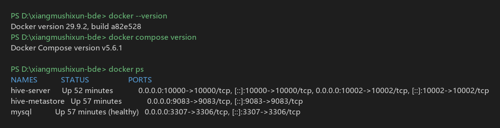
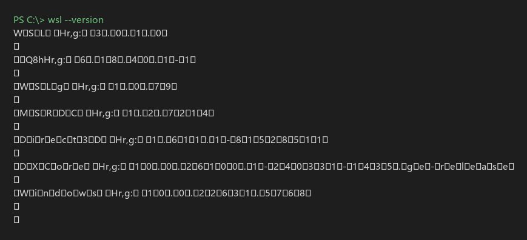
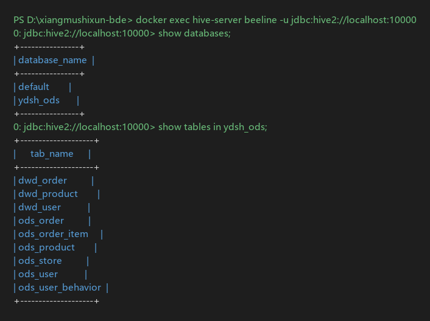
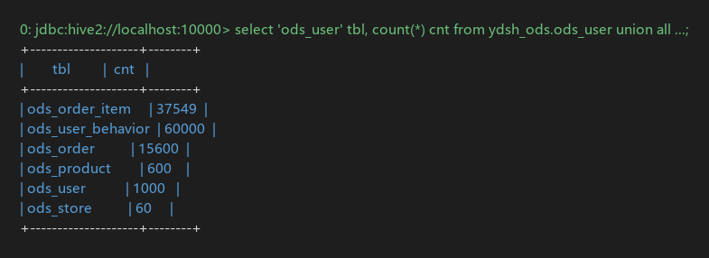

# 环境搭建笔记

> 记录第 1 周环境搭建过程中的实际问题与解决方案
> 环境：Windows 11 家庭中文版 22631 / Intel i5-13450HX / WSL 3.0.1 / Docker Desktop 4.96.3

## 一、最终环境清单

| 组件 | 版本 | 安装位置 |
|---|---|---|
| Docker Desktop | 4.96.3 | `D:\Docker\Docker` |
| WSL 运行时 | 3.0.1（内核 6.18.40） | 系统组件 |
| Git | 2.56.0 | `F:\Programs\Git` |
| MySQL | 8.0（容器） | 数据卷 `./data/mysql` |
| Apache Hive | 4.0.0（容器） | 镜像 1.6 GB |
| MySQL JDBC 驱动 | 8.0.33 | `./lib/`，挂载进 metastore |

## 二、遇到的问题与解决

### 问题 1：`docker --version` 命令不存在

**现象**：终端提示“无法将 docker 项识别为 cmdlet”。

**原因**：本机未安装 Docker Desktop。

**解决**：安装 Docker Desktop 4.96.3。官方源 `desktop.docker.com` 与 GitHub 均被网络阻断，改用阿里云镜像站的安装包，并用 `--installation-dir` 指定到 D 盘：

```powershell
"Docker Desktop Installer.exe" install --quiet --accept-license `
  --backend=wsl-2 --installation-dir="D:\Docker\Docker"
```

### 问题 2：安装后 Docker 无法启动，报 “WSL needs updating”

**现象**：Docker Desktop 界面提示 WSL 版本过旧。

**原因**：两层混淆——
- WSL2 **内核**（16 MB 的 msi）与 WSL **运行时**（220 MB 的 msixbundle）是两个东西；
- 已装内核 5.10.16，但运行时仍是系统自带 2.0.9，而 Docker 4.96 要求 **≥ 2.1.5**。

**解决**：安装 WSL 运行时 3.0.1。`wsl --update` 与微软商店渠道均因 CDN 被墙失败，最终从 GitHub Releases 下载 `Microsoft.WSL_3.0.3.0_x64_ARM64.msixbundle` 后安装。

**验证**：`wsl --version` 输出版本号即成功（旧版会报“命令行选项无效”）。

### 问题 3：Windows 功能已启用但仍不生效

**现象**：`Enable-WindowsOptionalFeature` 返回成功，重启后 WSL 仍不可用。

**原因**：Win11 的**快速启动（Fast Startup）**下，“关机再开机”实际是内核休眠恢复，`RebootPending` 标志不清除，`vmcompute` 服务不出现。

**解决**：必须用**开始菜单 → 重启**或 `shutdown /r`，不能用“关机”。

**验证**：`Get-Service vmcompute` 存在、`RebootPending = False`。

### 问题 4：容器启动失败，3306 端口被占用

**现象**：`docker compose up -d` 报 `bind: Only one usage of each socket address`。

**原因**：本机已安装 **MySQL80 服务**（PID 指向 mysqld），占用 3306。

**解决**：不改动本机 MySQL，把容器映射改为 `3307:3306`。容器之间通过 Docker 网络内部 3306 互连，不受影响。

**影响**：从宿主机连接容器内 MySQL 时需用 `localhost:3307`。

### 问题 5：hive-metastore 反复重启

**现象**：`docker ps` 显示 metastore `Restarting`，日志报：

```
MetaException(message:Version information not found in metastore.)
```

**原因**：compose 中设置了 `IS_RESUME: "true"`。在 `apache/hive` 镜像的入口脚本里，该变量的语义是**跳过 schema 初始化**（`SKIP_SCHEMA_INIT`），与字面理解相反。

**解决**：删除 `IS_RESUME`，让入口脚本自动执行 `schematool -initOrUpgradeSchema`。日志出现 `Initialized schema successfully..` 即成功。

### 问题 6：metastore 连不上 MySQL（缺驱动）

**现象**：即使配置了 JDBC 参数，仍无法建连。

**原因**：`apache/hive:4.0.0` 镜像只带 `hive-jdbc`（客户端驱动），**不含 `mysql-connector-j`**。

**解决**：下载 `mysql-connector-j-8.0.33.jar` 放入项目 `lib/`，挂载到容器 `/opt/hive/lib/`：

```yaml
volumes:
  - ./lib/mysql-connector-j-8.0.33.jar:/opt/hive/lib/mysql-connector-j-8.0.33.jar:ro
```

### 问题 7：质量评估 SQL 报 “Too many counters”

**现象**：25 个 `UNION ALL` 子查询的评估脚本执行失败：

```
Counters limit exceeded: Too many counters: 121 max=120
```

**原因**：Tez 单作业计数器上限 120，被大量子查询撑爆。`tez.counters.max` 参数在 Hive 4 中无法透传。

**解决**：把评估脚本拆成 5 条独立语句，按维度分别执行，每个作业的计数器远低于上限。

### 问题 8：镜像拉取超时

**现象**：`docker pull mysql:8.0` 报 `registry-1.docker.io: Client.Timeout exceeded`。

**原因**：Docker Hub 及多数国内加速器在校园网下 TLS 被重置。

**解决**：使用可用的镜像站 `docker.1panel.live`，拉取时带上前缀：

```powershell
docker pull docker.1panel.live/library/mysql:8.0
```

Hive 镜像（1.1 GB）通过镜像站回源极慢，最终走离线包 `docker load` 导入。

## 三、常用命令备忘

```powershell
# 启动/停止全部服务
docker compose up -d
docker compose down

# 查看状态
docker ps
docker compose logs -f hive-metastore

# 进入 Hive 客户端
docker exec -it hive-server beeline -u jdbc:hive2://localhost:10000

# 执行 SQL 脚本（脚本目录已挂载到容器 /sql）
docker exec hive-server beeline -u jdbc:hive2://localhost:10000 -f /sql/ods/create_ods.sql

# 连接容器内 MySQL（宿主机端口 3307）
mysql -h 127.0.0.1 -P 3307 -u hive -phive

# 确认 WSL 状态
wsl --version
wsl --status
```

## 四、停机与恢复

容器均设置 `restart: unless-stopped`，Docker Desktop 启动后会自动拉起。数据持久化在：

- `./data/mysql` —— MySQL 数据（含 Hive 元数据）
- `./data/warehouse` —— Hive 数仓表数据

只要这两个目录不删，重建容器后数据仍在。

## 五、关键运行记录

以下为环境搭建完成后的实际命令输出，用于证明环境可用。

**图 1　Docker 版本与三个容器运行状态**



**图 2　WSL 运行时版本（3.0.1，内核 6.18.40）**



**图 3　beeline 连接 Hive 并查看数据库与数据表**



**图 4　6 张 ODS 表行数校验结果**


