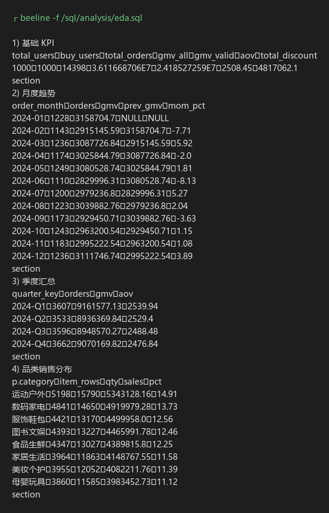

# 云购生活 · 探索性数据分析简报（第 2 周）

| 项目 | 内容 |
|---|---|
| 团队 | 乐天（余天乐，20230308098） |
| 分析对象 | `ydsh_dwd` 星型模型（订单 14,398 / 明细 34,979 / 行为 60,000 / 用户 1,000 / 商品 600 / 门店 60） |
| 分析脚本 | `第2周/sql/analysis/eda.sql`（19 组查询，全部基于 DWD 层） |
| 原始结果 | `第2周/evidence/eda.txt`（可逐条复核） |
| 分析日期 | 2026-11-02 |

---

## 一、指标口径

| 指标 | 口径 | 说明 |
|---|---|---|
| GMV（全量） | `sum(pay_amount)` | 含待支付、已取消、退款中订单 |
| GMV（有效） | `sum(pay_amount) where is_valid_revenue = 1` | 仅"已完成 + 已支付"，本报告的趋势/结构分析一律用全量，避免与订单量口径打架 |
| 订单量 | `count(*)` on `dwd_order` | 一行一单 |
| 客单价 AOV | `GMV / 订单量` | — |
| ARPU | `GMV / 下单用户数` | 用户维度的人均产出 |
| 品类销售额 | `sum(alloc_amount)` | 订单实付按明细占比分摊后的金额，可加总回 GMV |
| 统计区间 | 2024-01-01 ～ 2024-12-31 | 行为日志仅覆盖 2024-10 ～ 2024-12 |

---

## 二、核心 KPI

| 指标 | 数值 |
|---|---|
| 总用户数 | 1,000 |
| 下单用户数 | 1,000（**100% 用户有下单记录**） |
| 总订单量 | 14,398 |
| GMV（全量） | **36,116,687.06 元** |
| GMV（有效营收） | 24,185,272.59 元（占 66.96%） |
| 客单价 AOV | **2,508.45 元** |
| 人均消费 ARPU | 36,116.69 元 |
| 总优惠金额 | 4,817,062.10 元（占 GMV 13.34%） |
| 人均下单次数 | 14.40 次 |

---

## 三、销售趋势：稳定但无增长

### 3.1 月度（含环比）

| 月份 | 订单量 | GMV（元） | 环比 |
|---|---|---|---|
| 2024-01 | 1,228 | 3,158,704.70 | — |
| 2024-02 | 1,143 | 2,915,145.59 | **−7.71%** |
| 2024-03 | 1,236 | 3,087,726.84 | +5.92% |
| 2024-04 | 1,174 | 3,025,844.79 | −2.00% |
| 2024-05 | 1,249 | 3,080,528.74 | +1.81% |
| 2024-06 | 1,110 | 2,829,996.31 | **−8.13%** |
| 2024-07 | 1,200 | 2,979,236.80 | +5.27% |
| 2024-08 | 1,223 | 3,039,882.76 | +2.04% |
| 2024-09 | 1,173 | 2,929,450.71 | −3.63% |
| 2024-10 | 1,243 | 2,963,200.54 | +1.15% |
| 2024-11 | 1,183 | 2,995,222.54 | +1.08% |
| 2024-12 | 1,236 | 3,111,746.74 | +3.89% |

### 3.2 季度

| 季度 | 订单量 | GMV（元） | 客单价 |
|---|---|---|---|
| 2024-Q1 | 3,607 | 9,161,577.13 | 2,539.94 |
| 2024-Q2 | 3,533 | 8,936,369.84 | 2,529.40 |
| 2024-Q3 | 3,596 | 8,948,570.27 | 2,488.48 |
| 2024-Q4 | 3,662 | 9,070,169.82 | 2,476.84 |

**发现**：全年 GMV 在 283 万～316 万区间内小幅波动，季度间差异不足 3%，Q4 未见旺季翘尾。**规模稳定但缺乏增长动能**——这不是运营事故，而是"没有增量动作"的典型形态：订单量稳定（月均 1,200 单），客单价稳中有降（Q1 2,539.94 → Q4 2,476.84，降 2.5%）。

---

## 四、品类结构：八分天下，缺爆品

| 排名 | 品类 | 明细行数 | 销量（件） | 销售额（元） | 占比 |
|---|---|---|---|---|---|
| 1 | 运动户外 | 5,198 | 15,790 | 5,343,128.16 | **14.91%** |
| 2 | 数码家电 | 4,841 | 14,650 | 4,919,979.28 | 13.73% |
| 3 | 服饰鞋包 | 4,421 | 13,170 | 4,499,958.00 | 12.56% |
| 4 | 图书文娱 | 4,393 | 13,227 | 4,465,991.78 | 12.46% |
| 5 | 食品生鲜 | 4,347 | 13,027 | 4,389,815.80 | 12.25% |
| 6 | 家居生活 | 3,964 | 11,863 | 4,148,767.55 | 11.58% |
| 7 | 美妆个护 | 3,955 | 12,052 | 4,082,211.76 | 11.39% |
| 8 | 母婴玩具 | 3,860 | 11,585 | 3,983,452.73 | 11.12% |

**二级类目 Top 5**：球类 1,314,285.00、彩妆 1,206,300.41、运动服饰 1,203,172.95、香水 1,202,381.05、健身器材 1,187,708.62。

**单品 Top 3**：每日坚果大礼包 98,768.60（197 件）、精装文学名著 97,725.72（244 件）、滚筒洗衣机 90,238.75（204 件）。

**发现**：最高品类占比 14.91%，最低 11.12%，**结构高度均衡**；最畅销单品销售额不足 10 万元，仅占全年 GMV 的 0.27%。这组数据的形态说明：企业靠 600 个 SKU 的"长尾"撑起盘子，**没有明星单品**，也就没有流量抓手。品类策略上，运动户外 + 数码家电（合计 28.64%）是最适合做"主推组合"的两类。

---

## 五、区域分布：华东近四成，单用户产出无差异

| 大区 | 用户数 | 订单量 | GMV（元） | 占比 | ARPU | 客单价 |
|---|---|---|---|---|---|---|
| 华东 | 399 | 5,819 | 14,620,815.31 | **40.48%** | 36,643.65 | 2,512.60 |
| 华中 | 179 | 2,500 | 6,244,981.27 | 17.29% | 34,888.16 | 2,497.99 |
| 西南 | 136 | 1,948 | 4,939,733.42 | 13.68% | 36,321.57 | 2,535.80 |
| 西北 | 79 | 1,133 | 2,851,136.58 | 7.89% | 36,090.34 | 2,516.45 |
| 东北 | 75 | 1,083 | 2,710,473.46 | 7.50% | 36,139.65 | 2,502.75 |
| 华北 | 70 | 1,024 | 2,495,041.53 | 6.91% | 35,643.45 | 2,436.56 |
| 华南 | 62 | 891 | 2,254,505.49 | 6.24% | 36,363.00 | 2,530.31 |

**省份 Top 3**：陕西省 2,851,136.58（7.89%）、重庆市 2,713,752.62（7.51%）、辽宁省 2,710,473.46（7.50%）；最低为湖北省 1,717,175.63（4.75%）。

**发现**：各区的 **ARPU 高度接近（3.49 万～3.66 万，极差 5%）**，也就是说"华东京东卖得多"纯粹是因为**华东的用户多**（399 人 vs 华南 62 人），不是华东人更能买。结论很直接：**区域增长要靠拓客，而不是在存量里提客单价**。

---

## 六、门店分析

60 家门店全年平均 GMV 601,944.78 元，最高 S029 北京二店 708,051.42 元（285 单），最低门店 509,140.60 元，**极差仅 1.39 倍**，门店间经营水平高度一致（符合模拟数据的均匀分布特征）。

| 排名 | 门店 | 城市 | 订单量 | GMV（元） |
|---|---|---|---|---|
| 1 | 云购生活·北京二店 | 北京 | 285 | 708,051.42 |
| 2 | 云购生活·绍兴旗舰店 | 绍兴 | 257 | 701,667.58 |
| 3 | 云购生活·莆田旗舰店 | 莆田 | 262 | 689,778.99 |
| 4 | 云购生活·合肥购物中心店 | 合肥 | 262 | 687,358.86 |
| 5 | 云购生活·株洲一店 | 株洲 | 261 | 684,683.23 |

**发现**：没有"头部门店"，也没有明显掉队门店。对经营的含义是：**门店差异不是当前的主要矛盾**，坪效（`GMV / 营业面积`）留待第 4 周接入门店面积后计算。

---

## 七、渠道与支付：四分天下

| 渠道 | 是否线上 | 订单量 | GMV（元） | 占比 | 客单价 |
|---|---|---|---|---|---|
| APP | 是 | 3,704 | 9,195,081.93 | 25.46% | 2,482.47 |
| PC官网 | 是 | 3,569 | 9,024,568.52 | 24.99% | 2,528.60 |
| 门店 | 否 | 3,573 | 9,002,787.05 | 24.93% | 2,519.67 |
| 小程序 | 是 | 3,552 | 8,894,249.56 | 24.63% | 2,504.01 |

**线上合计 75.07%，线下门店 24.93%。**

| 支付方式 | 订单量 | GMV（元） | 订单占比 |
|---|---|---|---|
| 微信支付 | 3,827 | 9,668,087.14 | 26.58% |
| 支付宝 | 3,807 | 9,469,986.31 | 26.44% |
| 货到付款 | 3,408 | 8,459,532.11 | 23.67% |
| 银行卡 | 3,356 | 8,519,081.50 | 23.31% |

**发现**：四个渠道占比差距小于 1 个百分点，是典型的"全渠道均衡"形态；但**货到付款仍占 23.67%**，对一家线上占 75% 的新零售企业来说偏高，意味着履约成本与坏账风险，建议第 3 周把"货到付款订单的取消率"单独拉出来算（当前 `dim_order_status` 已支持）。

---

## 八、会员等级：体系尚未产生分层效果

| 会员等级 | 用户数 | 订单量 | GMV（元） | ARPU | 客单价 |
|---|---|---|---|---|---|
| 金卡会员 | 273 | 3,909 | 9,855,785.51 | 36,101.78 | 2,521.31 |
| 钻石会员 | 253 | 3,647 | 9,114,276.68 | 36,024.81 | 2,499.12 |
| 普通会员 | 244 | 3,546 | 8,943,794.11 | 36,654.89 | 2,522.22 |
| 银卡会员 | 230 | 3,296 | 8,202,830.76 | 35,664.48 | 2,488.72 |

**发现**：四个等级的 ARPU 极差只有 **2.78%**（35,664～36,655），客单价差异不足 1.4%——**会员等级与消费能力几乎无关**。这不是"会员运营做得好"，恰恰相反：说明等级只是一种标签，没有配套权益去拉开差距。

> 数据说明：本项目的模拟数据中会员等级与消费额是独立生成的，因此这个结论属于**数据特征**而非真实经营结论。但在真实企业里，"等级无差异"恰恰是最该警惕的信号，分析方法本身可复用。

---

## 九、时间分布：两处必须说明的局限

### 9.1 时段

| 时段 | 订单量 | GMV（元） |
|---|---|---|
| 00–06 凌晨 | 3,676 | 9,274,602.75 |
| 18–22 晚间 | 2,473 | 6,131,269.21 |
| 14–18 下午 | 2,349 | 5,934,144.51 |
| 06–09 早间 | 1,769 | 4,408,492.03 |
| 09–12 上午 | 1,764 | 4,461,488.62 |
| 22–24 深夜 | 1,224 | 3,001,555.81 |
| 12–14 午间 | 1,143 | 2,905,134.13 |

### 9.2 工作日 vs 周末

| 类型 | 订单量 | GMV（元） | 天数 | 日均订单 |
|---|---|---|---|---|
| 工作日 | 10,262 | 25,736,702.08 | 262 | 39.17 |
| 周末 | 4,136 | 10,379,984.98 | 104 | 39.77 |

**发现（局限声明）**：凌晨 0–6 点占 25.5% 订单，周末与工作日日均订单仅差 1.5%——这两个结果都不符合真实零售规律，原因是模拟数据的时间字段随机生成。因此**本节的时段结论不用于排班、促销时点等经营决策**，仅作为"分析方法跑通"的证明。真实数据接入后重跑同一套 SQL 即可得到可用结论。

---

## 十、用户价值分析（窗口函数）

### 10.1 累计消费 Top 10（`sum(...) over (partition by user_id order by order_timestamp)`）

| 用户 | 订单日期 | 本单金额 | 累计消费 | 第几单 |
|---|---|---|---|---|
| U000273 | 2024-12-08 | 4,514.01 | **56,841.56** | 20 |
| U000288 | 2024-12-25 | 3,892.74 | 53,973.28 | 17 |
| U000036 | 2024-12-31 | 1,142.76 | 52,426.20 | 20 |
| U000987 | 2024-12-24 | 3,855.78 | 51,143.22 | 18 |
| U000344 | 2024-12-21 | 2,742.98 | 50,340.68 | 20 |
| U000900 | 2024-11-30 | 481.95 | 49,819.26 | 19 |

### 10.2 用户消费分层

| 层级 | 用户数 | 用户占比 | GMV（元） | GMV 占比 | 人均订单 | 人均消费 |
|---|---|---|---|---|---|---|
| A 高价值（≥5 万） | 5 | 0.5% | 264,724.94 | 1.09% | 19.0 | 52,944.99 |
| **B 中高（2–5 万）** | **647** | **64.7%** | **18,812,971.95** | **77.79%** | 11.05 | 29,077.24 |
| C 普通（0.5–2 万） | 343 | 34.3% | 5,091,685.41 | 21.05% | 6.83 | 14,844.56 |
| D 低价值（<5 千） | 5 | 0.5% | 15,890.29 | 0.07% | 2.4 | 3,178.06 |

> 说明：分层仅统计"有效营收"订单（已完成 + 已支付），四层 GMV 合计 24,185,272.59 元，因此表内"GMV 占比"是**相对有效 GMV** 的口径；若换算成全量 GMV（36,116,687.06），B 层占比为 52.09%。

### 10.3 下单次数分布（复购）

| 指标 | 数值 |
|---|---|
| 人均下单次数 | 14.40 次 |
| 最少 | 4 次 |
| 最多 | 27 次（1 人） |
| 下单 15 次及以上用户 | 477 人（47.7%） |

**发现**：**100% 用户都是重复购买者**（最少 4 单），复购不是问题；真正的问题在客单价——人均 14.4 单却只贡献 3.6 万元，说明**"买得多、买得小"**。B 层 647 人贡献了有效 GMV 的 77.8%（占全量 GMV 52.1%），是运营的主战场。

---

## 十一、行为分析

| 行为类型 | 行为量 | 覆盖用户 | 覆盖商品 | 相对"浏览"的比例 |
|---|---|---|---|---|
| 浏览 | 34,160 | 1,000 | 600 | 100% |
| 购买 | 11,969 | 1,000 | 600 | 35.04% |
| 加购 | 8,286 | 1,000 | 600 | 24.26% |
| 收藏 | 5,585 | 995 | 600 | 16.35% |

| 月份 | 浏览 | 加购 | 收藏 | 购买 |
|---|---|---|---|---|
| 2024-10 | 11,457 | 2,696 | 1,834 | 3,951 |
| 2024-11 | 11,193 | 2,722 | 1,877 | 3,910 |
| 2024-12 | 11,510 | 2,868 | 1,874 | 4,108 |

**发现（局限声明）**：`购买`(11,969) 大于 `加购`(8,286)，说明四类行为是独立采样的，不是同一批会话的完整路径。因此**不计算"加购→购买"转化率**，只把行为量当作"用户兴趣强度"的近似指标。12 月加购量环比 +5.4%，是三个月里唯一上升的指标，可作为关注点。

---

## 十二、核心发现与建议

| # | 发现（有数据支撑） | 数据依据 | 建议动作 |
|---|---|---|---|
| 1 | 规模稳定但无增长 | 月 GMV 283–316 万，季度差异 <3%，客单价 Q1→Q4 降 2.5% | 从"守规模"转向"提客单"：围绕 B 层用户做套装/满减，目标客单价 +5% |
| 2 | 无明星单品，靠长尾 | 最畅销单品仅占 GMV 0.27%，8 大品类占比 11.1%–14.9% | 选"运动户外 + 数码家电"（合计 28.6%）做组合主推，人为打造 2–3 个爆品 |
| 3 | 区域差异由用户数决定，非消费力 | 各区 ARPU 极差 5%，华东用户 399 vs 华南 62 | 拓客优先投向华中/西南（ARPU 与华东持平但基数小） |
| 4 | 线上占 75%，门店仍是四分之一 | APP 25.46% + PC 24.99% + 小程序 24.63% vs 门店 24.93% | 门店不做"卖货"做"履约+体验"，用坪效（需面积数据）而非 GMV 考核 |
| 5 | 货到付款占 23.67% | 3,408 单 / 846 万元 | 评估 COD 的履约成本与取消率，逐步引导至线上支付 |
| 6 | 会员等级无分层效果 | 四等级 ARPU 极差 2.78% | 重构权益（等级挂钩折扣/免运费），让等级"值钱" |
| 7 | 用户高频低额，B 层是主战场 | 人均 14.4 单、647 人贡献有效 GMV 的 77.8% | 对 B 层做"提频次→提客单"动作；A 层仅 5 人，做 1v1 维护 |

---

## 十三、数据局限（结论适用范围）

| 局限 | 影响 | 处理方式 |
|---|---|---|
| 下单时间随机分布 | 时段、周末效应结论不可用 | 已在第九节声明，仅作方法验证 |
| 会员等级与消费独立生成 | 会员分析结论是数据特征，非经营结论 | 已在第八节标注 |
| 行为日志非严格漏斗 | 不算转化率链路 | 只做行为体量对比 |
| 仅 2024 年数据 | 无法做同比（YoY） | 用环比（MoM）与季度对比替代 |
| 明细覆盖 99.2% 订单 | 114 单无明细 | 品类/商品分析基于 14,284 单，已在报告中注明 |
| 无成本、无退货明细 | 算不了毛利、退货率 | 待第 3 周补充数据源后再扩展 |

---

## 附：分析脚本结构（`第2周/sql/analysis/eda.sql`）

| 序号 | 分析内容 | 用到的技术点 |
|---|---|---|
| 1 | 基础 KPI | 多聚合 + 条件聚合 |
| 2 | 月度趋势与环比 | `lag() over (order by month)` |
| 3 | 季度汇总 | `year()` / `quarter()` |
| 4–6 | 品类 / 二级类目 / 单品 | 三表 JOIN + `sum(sum()) over ()` 算占比 |
| 7–9 | 省份 / 大区 / 门店 | 星型 JOIN |
| 10–12 | 渠道 / 支付 / 会员 | 条件聚合 |
| 13–14 | 时段 / 周末 | `case when` 分桶 + `dim_date` 关联 |
| 15 | 用户累计消费 | `sum() over (partition by user_id order by order_timestamp rows between unbounded preceding and current row)` |
| 16–17 | 用户分层 / 复购 | 窗口 `row_number()` + 子查询分层 |
| 18–19 | 行为漏斗 / 月度行为 | 条件聚合 |