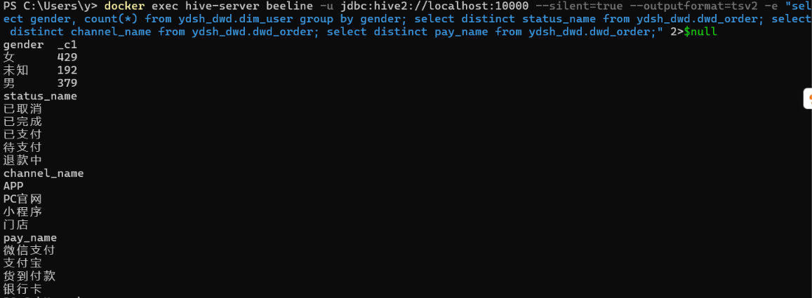
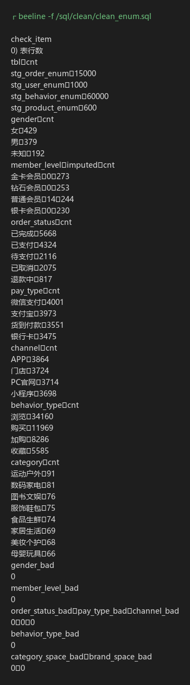
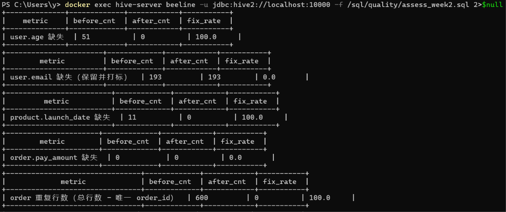

# 云购生活 · 数据质量清洗报告（第 2 周）

| 项目 | 内容 |
|---|---|
| 项目名称 | 云购生活新零售企业 · 企业级数据仓库与经营分析可视化系统 |
| 团队 | 乐天（余天乐，20230308098） |
| 报告版本 | v2.0（第 2 周：清洗进阶） |
| 对比对象 | 清洗前 `ydsh_ods.ods_*` vs 清洗后 `ydsh_dwd.*` |
| 统计口径 | **修复率 = (清洗前问题数 − 清洗后问题数) / 清洗前问题数 × 100%** |
| 数据证据 | `第2周/evidence/scan_ods.txt`（扫描）、`clean_enum.txt`、`clean_format.txt`、`clean_split_merge.txt`、`quality_compare.txt`（对比） |

---

## 一、报告概述

### 1.1 数据范围

| 表 | 清洗前行数 | 清洗后行数 | 行数变化原因 |
|---|---|---|---|
| 用户 `user` | 1,000 | 1,000 | 不删行，异常值修正 + 标记 |
| 商品 `product` | 600 | 600 | 不删行，异常价格修正 + 标记 |
| 门店 `store` | 60 | 60 | 本身干净，仅去空格 |
| 订单 `order` | 15,600 | 14,398 | −600 重复、−602 金额异常 |
| 订单明细 `order_item` | 37,549 | 34,979 | −1,081 数量异常、−1,489 属被删订单 |
| 行为日志 `behavior` | 60,000 | 60,000 | 仅格式标准化，不删行 |
| **合计** | **114,809** | **111,037** | **−3,772（3.28%）** |

### 1.2 本周清洗的两条主线

1. **清洗一（第 1 周）解决"少"和"多"**：缺失值填充（年龄、上架日期）、重复订单去重。
2. **清洗二（本周）解决"乱"和"错"**：枚举取值不规范、金额/数量异常、日期与手机号格式混杂、字段需要拆分合并。

### 1.3 问题条目统计（按问题计，同一行可能命中多类）

| 脏数据类型 | 问题条目数 | 占比 |
|---|---|---|
| 完整性（缺失） | 255 | 0.35% |
| 唯一性（重复） | 600 | 0.83% |
| 一致性（格式） | 8,217 | 11.39% |
| 准确性（异常值） | 2,564 | 3.55% |
| 有效性（枚举不规范） | 60,520 | 83.88% |
| **合计** | **72,156** | **100%** |

> 有效性占大头是因为按"统一中文标准值"的口径，行为日志里 57,551 条 `pv/buy/cart/fav` 英文缩写与大小写变体都算不规范。这类问题**不影响数值正确性，但影响分组统计**——不统一的话，`pv` 和 `浏览` 会被 group by 成两组，漏斗直接算错。

---

## 二、问题清单（清洗前实测）

### 2.1 完整性：缺失值

| 字段 | 缺失数 | 占该表 | 表现 |
|---|---|---|---|
| `user.age` | 51 | 5.10% | 空字符串 |
| `user.email` | 193 | 19.30% | 空字符串 |
| `product.launch_date` | 11 | 1.83% | 空字符串 |
| `order.pay_amount` | 0 | 0% | 无缺失 |

### 2.2 唯一性：重复值



| 检查项 | 结果 |
|---|---|
| `ods_order` 总行数 | 15,600 |
| `order_id` 唯一数 | 15,000 |
| 整行完全重复 | 400 行 |
| 同 `order_id` 但字段不同（异构重复） | 200 行 |
| **合计重复行** | **600 行** |
| `order_item.item_id` / `behavior.behavior_id` 重复 | 0 |

### 2.3 一致性：格式不统一

| 字段 | 问题数 | 具体表现 |
|---|---|---|
| `user.register_date` | 125 | `2023/11/25` 式 100 条 + `20231125` 式 25 条 |
| `user.phone` | 102 | `138-9212-7520` 带横线 |
| `order.order_date` | 1,902 | `2024/07/26` 斜杠式 |
| `behavior.behavior_time` | 6,088 | `2024/11/05 10:20` 斜杠式且缺秒 |
| `order.order_time` | 0 | 全部为 `HH:mm:ss` |

### 2.4 准确性：异常值

| 字段 | 问题数 | 实测分布特征 |
|---|---|---|
| `order.pay_amount < 0` | 310 | 最小 −4,994.73 |
| `order.pay_amount` 超大 | 312 | >100,000，最大 9,957,781.93 |
| `user.age < 1 或 > 120` | 27 | 含 −3、200 等注入值 |
| `product.price ≤ 0 或 > 100,000` | 36 | 负价 20 条、超高价 16 条（最高 849,897.90） |
| `order_item.quantity ≤ 0 或 > 50` | 1,081 | 0 值 386 条、−2 值 332 条、99 值 363 条 |
| `order_item.unit_price ≤ 0` | 798 | 最低 −8,992.96 |

### 2.5 有效性：枚举取值不规范（含取值种类）

| 字段 | 清洗前取值种类 | 不规范条数 | 典型脏值 |
|---|---|---|---|
| `user.gender` | 8 | 498 | 男/女/M/F/male/female/未知/空 |
| `user.member_level` | 12 | 108 | 金卡会员/金卡/gold/钻石/silver/normal/空 |
| `order.order_status` | 12 | 1,375 | 已完成/完成/3/已支付/2/待支付/1/已取消/cancelled/4/退款中 |
| `order.pay_type` | 7 | 651 | 支付宝/alipay/微信支付/微信/wechat/银行卡/货到付款 |
| `order.channel` | 6 | 310 | APP/app/PC官网/pc/小程序/门店 |
| `behavior.behavior_type` | 10 | 57,551 | pv/PV/浏览、cart/Cart/加购、fav/收藏、buy/购买 |
| `product.category` | 16 | 27 | 8 个类目各带"尾巴空格"变体 |

---

## 三、处理策略（逐条：策略 + 依据 + 影响）

### 3.1 枚举字段标准化（子任务 1）

**策略**：先 `select distinct` 全量扫描取值，再逐值列出 `case when` 映射；中国式取值（男/女、金卡会员…）作为标准值，英文缩写与编码统一翻译过来；空值按业务有意义的默认值补全并打标。

| 字段 | 标准值域 | 映射规则要点 | 空值处理 |
|---|---|---|---|
| `gender` | 男 / 女 / 未知 | 男,male,m → 男；女,female,f → 女 | 空 → 未知 |
| `member_level` | 普通会员 / 银卡会员 / 金卡会员 / 钻石会员 | 金卡,gold → 金卡会员；钻石,diamond → 钻石会员 | 空 → 普通会员，打 `level_imputed=1`（14 条） |
| `order_status` | 待支付 / 已支付 / 已完成 / 已取消 / 退款中 | 数字码 1→待支付、2→已支付、3→已完成、4→已取消 | 无 |
| `pay_type` | 支付宝 / 微信支付 / 银行卡 / 货到付款 | alipay → 支付宝；微信,wechat → 微信支付 | 无 |
| `channel` | 门店 / APP / 小程序 / PC官网 | app → APP；pc → PC官网 | 无 |
| `behavior_type` | 浏览 / 加购 / 收藏 / 购买 | pv → 浏览；cart → 加购；fav → 收藏；buy → 购买 | 无 |

**文本规范化**：`category`、`sub_category`、`brand` 统一 `trim` + 压缩内部空白 + `upper`。中文不受大小写影响，规则用于兜底英文品牌（如 Nike/NIKE），保证后续新增数据也不会再出现"同一类目两组"。

**验收**：清洗后各字段 `not in (标准值域)` 的条数全部为 **0**；取值种类 8→3、12→4、12→5、7→4、6→4、10→4、16→8。



### 3.2 异常值处理（子任务 2 上半）

| 对象 | 判定规则 | 处理方式 | 条数 | 理由 |
|---|---|---|---|---|
| 订单实付金额 | `< 0` | **删除** | 310 | 负支付在业务上不成立，且无法推断真实值 |
| 订单实付金额 | `> 11,356.33` | **删除** | 312 | 见下方"阈值为什么不用 P99" |
| 用户年龄 | `< 1 或 > 120` | 用有效年龄均值填充（第 1 周）+ 边界强校验 | 27 | 年龄是强业务约束（1～120） |
| 商品售价 | `≤ 0 或 > 100,000` | **按同类目商品价格中位数修正** + `price_fixed=1` | 36 | 维度表不能删行，否则事实表外键悬空 |
| 明细数量 | `≤ 0 或 > 50` | **删除** | 1,081 | 正常取值只有 1～5，0/负数无意义，99 是 20 倍离群 |
| 明细单价 | `≤ 0` | **按同商品有效单价中位数修正** + `price_fixed=1` | 773（清洗后口径） | 单价为负会让明细金额为负、分摊失效 |

**阈值为什么不用手册建议的 P99**

实测 `pay_amount` 分位数：P50 = 2,542.53，P95 = 4,835.89，**P99 = 5,516,776.62**，P99.9 = 9,309,919.35。

P99 之所以被抬到 550 万，是因为异常值占 3.8%（312/15,600），**已经超过 1%**，第 99 百分位本身就落在异常值堆里——按 P99 当上限，291 条百万级脏数据会被当成"正常大额订单"保留下来。

改用**箱线图 IQR 法**：

```
Q1 = 1,293.39，Q3 = 3,809.12，IQR = 2,515.74
上限 = Q3 + 3 × IQR = 11,356.33
```

再验证业务合理性：正常订单金额 14,978 条全部 ≤ 5,000 元，异常订单 312 条全部 ≥ 100,000 元，**5,000～100,000 元之间一条数据都没有**——金额分布在 5 千到 10 万之间存在明显断崖，IQR 上限落在断崖内，既不会误删正常大额订单，也不会漏掉异常值。

**明细单价为什么不用删除而用修正**

第一次跑 ETL 时发现"明细分摊金额合计 35,231,857.66 元，比有明细订单实付 35,833,304.41 元少了 60 万"，排查后定位到 773 条负单价：`quantity × unit_price` 为负，导致订单明细金额合计 ≤ 0，分摊公式按 `order_amt > 0` 的保护直接返回 0。改为"用同商品有效单价中位数修正"后，分摊闭合误差降到 **0.65 元**。这是一个必须记录的真实踩坑：**异常值不处理干净，下游的窗口函数会静默算错，而不会报错。**

### 3.3 格式标准化（子任务 2 下半）

| 字段 | 原格式 | 统一为 | 实现方式 |
|---|---|---|---|
| `register_date`、`order_date`、`launch_date`、`open_date` | `yyyy-MM-dd` / `yyyy/MM/dd` / `yyyyMMdd` | `yyyy-MM-dd` | 8 位数字拆段，其余把 `/` 替换成 `-` |
| `phone` | `13892127520` / `138-9212-7520` | 11 位纯数字 | `regexp_replace(phone, '[^0-9]', '')` 后校验长度 |
| `behavior_time` | `yyyy-MM-dd HH:mm:ss` / `yyyy/MM/dd HH:mm` | `yyyy-MM-dd HH:mm:ss` | 斜杠换横线，缺秒补 `:00` |
| `order_timestamp` | 无（需合并） | `yyyy-MM-dd HH:mm:ss` | `concat(order_date, ' ', order_time)` |

**手机号的处理细节**：先剥离非数字字符，再判断长度。102 条带横线的号码剥离后正好 11 位，直接可用；若剥离后长度不足 11 位，用补位处理并打 `phone_fixed=1`（本次数据 0 条触发，规则留作兜底）。

### 3.4 字段拆分合并与编码映射（子任务 3）

| 需求 | 做法 | 结果 |
|---|---|---|
| `order_date` + `order_time` → `order_timestamp` | `concat(order_date, ' ', order_time)` | 14,398 条全部符合 `yyyy-MM-dd HH:mm:ss`（不合规 0 条） |
| `province` + `city` → `region` | `concat(province, '-', city)` | 1,000 条全部有值，无空值 |
| 由省份派生七大区 | `region_area`（华北/东北/华东/华中/华南/西南/西北） | 15 个省份全覆盖，"其他" 0 条 |
| 会员等级/支付方式等编码映射 | 建 4 张微型维表，事实表只存 code | 关联未命中数全部为 0 |

**4 张编码映射维表**

| 表 | 编码 | 名称 | 附加属性 |
|---|---|---|---|
| `dim_member_level` | L1–L4 | 普通/银卡/金卡/钻石会员 | `level_rank` 1–4 |
| `dim_pay_type` | P1–P4 | 支付宝/微信支付/银行卡/货到付款 | `pay_category` 第三方支付/银行渠道/线下支付 |
| `dim_order_status` | S1–S5 | 待支付/已支付/已完成/已取消/退款中 | `is_paid`、`is_valid_revenue` |
| `dim_channel` | C1–C4 | 门店/APP/小程序/PC官网 | `is_online` |

> 为什么值得单独建表：`order_status` 的"是否计入营收"这种业务口径，写死在 `case when` 里会散落在每个 SQL 中；做成维表后只有一处定义，ADS 层算 GMV 时直接 `join ... where is_valid_revenue = 1`，口径不会漂移。

---

## 四、清洗前后对比表（子任务 4 核心交付）

### 4.1 五类脏数据修复率



| 类别 | 指标 | 清洗前 | 清洗后 | 修复率 |
|---|---|---|---|---|
| **完整性** | `user.age` 缺失 | 51 | 0 | **100%** |
| 完整性 | `user.email` 缺失 | 193 | 193 | 0%（保留并标记） |
| 完整性 | `product.launch_date` 缺失 | 11 | 0 | **100%** |
| 完整性 | `order.pay_amount` 缺失 | 0 | 0 | 无缺失 |
| **唯一性** | `order` 重复行 | 600 | 0 | **100%** |
| 唯一性 | 明细/行为主键重复 | 0 | 0 | 无重复 |
| **一致性** | `register_date` 非标准 | 125 | 0 | **100%** |
| 一致性 | `phone` 非 11 位纯数字 | 102 | 0 | **100%** |
| 一致性 | `order_date` 非标准 | 1,902 | 0 | **100%** |
| 一致性 | `behavior_time` 非标准 | 6,088 | 0 | **100%** |
| 一致性 | `order_timestamp` 非标准 | — | 0 | 新增字段，全合规 |
| **准确性** | `pay_amount` 负金额 | 310 | 0 | **100%** |
| 准确性 | `pay_amount` 超大金额 | 312 | 0 | **100%** |
| 准确性 | `age` 越界（<1 或 >120） | 27 | 0 | **100%** |
| 准确性 | `price` 异常 | 36 | 0 | **100%** |
| 准确性 | `quantity` 异常 | 1,081 | 0 | **100%** |
| 准确性 | `unit_price` 异常 | 798 | 0 | **100%** |
| **有效性** | `gender` 非规范 | 498 | 0 | **100%** |
| 有效性 | `member_level` 非规范 | 108 | 0 | **100%** |
| 有效性 | `order_status` 非规范 | 1,375 | 0 | **100%** |
| 有效性 | `pay_type` 非规范 | 651 | 0 | **100%** |
| 有效性 | `channel` 非规范 | 310 | 0 | **100%** |
| 有效性 | `behavior_type` 非规范 | 57,551 | 0 | **100%** |
| 有效性 | `category` 带空格 | 27 | 0 | **100%** |

> 说明：`pay_amount` 负金额/超大连同订单一起删除，属"删除式修复"；`price`、`unit_price`、`age`、`member_level` 属"修正式修复"；`email` 属"标记不修复"。三种策略都在表里如实标注，不做"修复率 100%"的一刀切美化。

### 4.2 枚举取值种类收敛

| 字段 | 清洗前种类 | 清洗后种类 | 标准值域 |
|---|---|---|---|
| `gender` | 8 | **3** | 男 / 女 / 未知 |
| `member_level` | 12 | **4** | 普通 / 银卡 / 金卡 / 钻石会员 |
| `order_status` | 12 | **5** | 待支付 / 已支付 / 已完成 / 已取消 / 退款中 |
| `pay_type` | 7 | **4** | 支付宝 / 微信支付 / 银行卡 / 货到付款 |
| `channel` | 6 | **4** | 门店 / APP / 小程序 / PC官网 |
| `behavior_type` | 10 | **4** | 浏览 / 加购 / 收藏 / 购买 |
| `category` | 16 | **8** | 数码家电 / 服饰鞋包 / 食品生鲜 / 美妆个护 等 8 大类 |

### 4.3 清洗后质量基线（DWD 层）

| 校验项 | 结果 |
|---|---|
| 订单金额区间 | 20.33 ～ 4,999.85（全部落在正常区间） |
| 用户年龄区间 | 1 ～ 120（越界 0 条） |
| 商品价格区间 | 28.77 ～ 8,992.57（无负价、无超高价） |
| 明细数量区间 | 1 ～ 5 |
| 明细单价区间 | 20.00 ～ 8,998.97 |
| 主键唯一性 | 订单 14,398 行 / 14,398 个 `order_id`，明细、行为同样无重复 |
| 外键完整性 | 订单→用户/门店、明细→商品、行为→用户/商品，**孤儿数均为 0** |
| 金额闭合 | 明细分摊合计 35,833,305.06 vs 有明细订单实付 35,833,304.41（差 0.65 元） |

---

## 五、遗留问题说明（不回避，逐条说明原因与影响）

| 序号 | 遗留问题 | 原因 | 影响 | 后续处理 |
|---|---|---|---|---|
| 1 | `email` 193 条仍为空 | 业务上邮箱非必填，伪造会污染用户触达分析 | 用户画像中的联系维度不完整 | 保留 `email_missing` 标记，第 4 周做用户分层时按"有/无邮箱"分组即可 |
| 2 | 明细金额与订单实付不能直接加总 | 原始数据两者本就不匹配（平均绝对差 141,508.12 元/单） | 直接用 `item_amount` 算品类占比，合计 ≠ GMV | 已增加 `alloc_amount` 分摊字段，品类分析一律用它 |
| 3 | 114 个订单清洗后没有明细 | 这些订单的明细行数量/单价全部异常，被整体删除 | 明细覆盖 14,284/14,398 = 99.2% | 订单级 GMV 不受影响；明细级分析已声明覆盖率 |
| 4 | 下单时间分布过于均匀（凌晨 0–6 点占 25.5%） | 模拟数据的时间字段随机生成 | 时段分析结论不可用于真实排班决策 | 在《探索性分析简报》中标注为数据局限，不作为业务建议 |
| 5 | 会员等级与消费能力无明显差异（ARPU 35,664～36,655 元） | 模拟数据中等级与消费额独立生成 | 无法用数据验证会员体系价值 | 同上，作为"数据局限"说明，建议真实业务落地后复算 |
| 6 | 行为日志 `buy`(11,969) > `cart`(8,286) | 各类行为独立采样，不是同一批会话的完整路径 | 不能计算严格的漏斗转化率 | 只做行为体量对比，不宣称"加购→购买转化率" |
| 7 | 2023 年行为/订单数据缺失（仅 2024 年有订单） | 数据集设计如此 | 同比分析（YoY）做不了 | 第 3 周做月度环比（MoM），不做同比 |

---

## 六、清洗脚本清单与执行顺序

| 顺序 | 脚本 | 作用 | 产物 | 实测耗时 |
|---|---|---|---|---|
| 1 | `第2周/sql/clean/clean_missing.sql`（第 1 周） | 缺失值填充 | `ydsh_ods.dwd_user`、`dwd_product` | 约 20 s |
| 2 | `第2周/sql/clean/clean_duplicate.sql`（第 1 周） | 订单去重 | `ydsh_ods.dwd_order` | 约 20 s |
| 3 | `第2周/sql/clean/clean_enum.sql` | 枚举标准化 + 文本规范化 | `stg_*_enum`（4 张） | 约 35 s |
| 4 | `第2周/sql/clean/clean_format.sql` | 异常值 + 格式标准化 | `stg_*_fmt`（5 张）+ 2 张中位数辅助表 | 约 42 s |
| 5 | `第2周/sql/clean/clean_split_merge.sql` | 时间戳合并 / region 合并 / 编码映射 | 4 张映射维表 + `stg_user_dim`、`stg_order_fact` | 约 31 s |
| 6 | `第2周/sql/quality/assess_week2.sql` | 前后对比统计 | 本文第四节全部数据 | 约 224 s |

每个脚本末尾都带**自校验语句**（行数、残留脏值计数、格式正则校验），返回值全部为 0 才算通过，避免"跑完就以为对了"。

---

## 七、结论

1. 五类脏数据的**可修复项修复率全部达到 100%**，其中删除式修复 1,683 条（订单 602 + 明细 1,081），修正式修复 861 条（单价 773 + 价格 36 + 年龄 27 + 等级 14 + 上架日期 11），标记式处理 193 条（邮箱缺失）。
2. 数据总量从 114,809 行降到 111,037 行，**删除比例 3.28%**，删除的每一类都有业务依据和条数记录，可追溯到具体规则。
3. 枚举取值全部收敛到规范值域，为下游 `group by` 与漏斗分析扫清了障碍——这是本周对分析质量提升最大的一项。
4. 有 7 项遗留问题已如实登记，其中"明细与订单金额口径不一致""时间分布随机"两项会直接影响分析结论的解读，已在《探索性分析简报》对应位置标注。