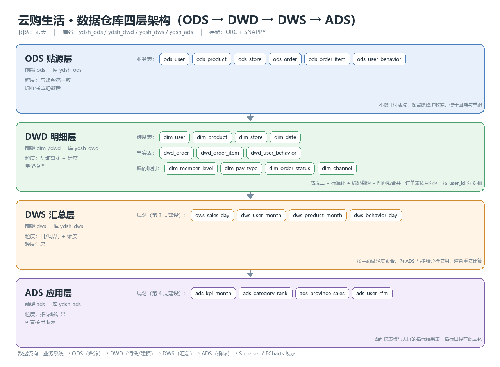
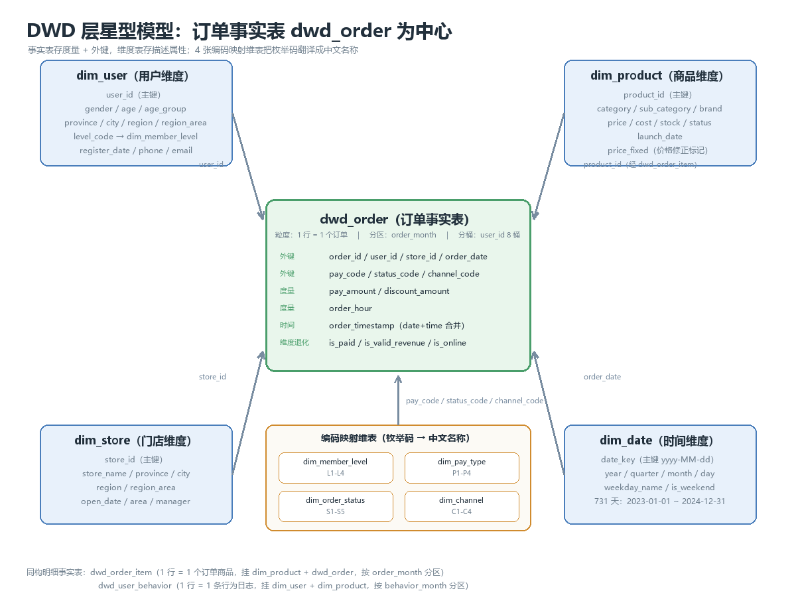

# 云购生活 · 架构设计文档

| 项目 | 内容 |
|---|---|
| 项目名称 | 云购生活新零售企业 · 企业级数据仓库与经营分析可视化系统 |
| 团队 / 作者 | 乐天（余天乐，20230308098） |
| 文档版本 | v5.0（项目级，覆盖 ODS→DWD→DWS→ADS→服务层→应用层→部署 全链路） |
| 编写日期 | 2026-11-23 |
| 依据 | 《第 5 周任务书》子任务 2：编写《架构设计文档》（四层架构、维度建模、技术选型） |
| 前序版本 | 第 2 周《数仓架构设计文档》v2.0（当时只覆盖到 DWD 层，DWS/ADS 为"预留设计"） |
| 规模 | 4 个库 / 51 张表 / 9 个容器服务 / 3 个可视化终端 / 10 个数据接口 |

---

## 一、设计目标与约束

### 1.1 五个目标

1. **可分层**：ODS→DWD→DWS→ADS 各司其职，任何一层出问题都能定位到上游，不允许跨层取数；
2. **可追溯**：每个指标都能回答"公式是什么、来自哪张表、原始字段是哪个"；
3. **口径唯一**：同一指标只在一个地方定义（GMV 只在 `dwd_order.pay_amount` + `ads_kpi_*` 定义一次）；
4. **可复现**：脚本幂等、一键起服务，换机器不需要"手工调半天"；
5. **够快**：演示时大屏首屏 3 秒内可交互，单月查询不全表扫描。

### 1.2 三条硬约束（决定了后面所有设计）

| 约束 | 现实条件 | 设计上的应对 |
|---|---|---|
| 数据量小（11 万行）、算力有限（单机 Docker，内存 ≈ 5.2 GB 占用） | 不上集群、不上 Spark | Hive on Tez 单机足够；把"算"前移到 DWS/ADS，把"读"交给 ClickHouse |
| 数据只有 2024 一年 | 同比不可做 | 分层里不含"去年同期"的预聚合，ADS 不预留 YoY 字段（`gmv_yoy` 恒为 NULL 并注明） |
| 模拟数据存在结构性缺陷（明细与订单金额对不上、时间随机） | 不能靠"清洗"解决 | 用 `alloc_amount` 分摊字段隔离口径；把缺陷写进文档而不是藏起来 |

---

## 二、总体架构



系统分**五个平面**，从上到下是"数据怎么进来、怎么被加工、怎么被服务、怎么被看见、怎么被部署"：

```
┌───────────────────────────────────────────────────────────────────────┐
│ ⑤ 部署与运维面   Docker Compose（9 服务 = 7 常驻 + 2 一次性任务）        │
│                  healthcheck 依赖编排 / 命名卷 / .env 注入               │
├───────────────────────────────────────────────────────────────────────┤
│ ④ 应用与展示面   Superset 仪表板(6图)  ECharts 大屏(7图)  Streamlit 问答 │
│                  FastAPI 数据服务(10 接口) + 静态托管                    │
├───────────────────────────────────────────────────────────────────────┤
│ ③ 服务层         ClickHouse ydsh_ads（11 表副本，30~50 ms）              │
│                  MySQL ydsh_mysql（3 表 KPI 快照，只读账号 ydsh_ro）      │
├───────────────────────────────────────────────────────────────────────┤
│ ② 数仓层         ADS 11 → DWS 9 → DWD 25 → ODS 6      （共 51 张表）     │
│                  Hive 4.0.0 on Tez，ORC + SNAPPY，按月分区                │
├───────────────────────────────────────────────────────────────────────┤
│ ① 数据源         6 个 CSV（11.48 万行）+ MySQL 元数据库                   │
└───────────────────────────────────────────────────────────────────────┘
```

**为什么服务层单独成一个平面**：Hive on Tez 每次查询都有会话/编译开销（实测 1～15 秒），大屏 7 个面板刷新一次要几十秒，演示无法接受；ADS 结果集只有 2,666 行，复制一份到 ClickHouse 后同样查询 30～50 ms。**注意：ClickHouse 不是第二套数仓，不做 ETL，只是结果集副本**——口径改了重跑 `export_to_clickhouse.py` 即可。

---

## 三、技术选型与理由

| 层次 | 选型 | 版本 | 为什么选它 | 考虑过但没选 |
|---|---|---|---|---|
| 数仓引擎 | Apache Hive（Tez） | 4.0.0 | 课程要求；SQL 方言贴近 MySQL；分区/分桶能力完整；单机 Docker 可跑 | Spark SQL（内存不够）、ClickHouse 直做数仓（不支持 UPDATE/事务，建模不便）、Doris（镜像太重） |
| 元数据库 | MySQL | 8.0 | Hive Metastore 官方支持；同时可复用为 Superset 元数据库 + 业务快照库 | PostgreSQL（多一个组件，收益不大） |
| 存储格式 | ORC + SNAPPY | — | 列式 + 可控压缩；`dwd_order` 12 分区合计 933 KB（原始 CSV 1.38 MB） | Parquet（Hive 4 支持但 ORC 在本项目谓词下推更稳）、TextFile（DWD 层不该用它） |
| 服务层缓存 | ClickHouse | 24.8 | 单表毫秒级；SQL 与 Hive 基本兼容，接口层可同一句 SQL 打两个引擎 | Redis（只适合 KV，做不了聚合）、DuckDB（进程内，容器共享不便） |
| BI | Apache Superset | 4.1.2 | 原生支持 Hive/MySQL 数据源、筛选器与交叉联动；可全 REST API 自动化建看板 | Metabase（API 弱）、Tableau（商业授权） |
| 大屏 | ECharts | 5.5.1（本地化） | 图表类型全（地图/热力/散点/双轴）；可离线（断网可演示） | DataV（闭源）、D3（开发成本高） |
| 问答应用 | Streamlit | 1.67 | 纯 Python 出交互页；适合"提问→SQL→表格→图"单链路 | Vue/React 自研（工期不允许） |
| 数据服务 | FastAPI + uvicorn | — | 自动生成 OpenAPI 文档；异步；与 pandas 协作顺 | Flask（无自动文档）、Django（过重） |
| 大模型 | 智谱 GLM-4-Flash | glm-4-flash-250414 | 免费档、OpenAI 协议兼容、中文 SQL 能力够用 | DeepSeek（按量计费，已内置为可切换项）、本地 Ollama（机器扛不住 7B） |
| 容器化 | Docker Compose | v2 | 单机多服务编排 + healthcheck 依赖顺序，正好覆盖本项目 | K8s（远超课程需要） |
| 版本控制 | Git + GitHub | — | 分支/PR 记录可作为工程化证据 | — |

---

## 四、四层数仓设计

### 4.1 分层职责

| 分层 | 库名 | 表数 | 定位 | 粒度 | 存储 | 是否分区 |
|---|---|---|---|---|---|---|
| ODS | `ydsh_ods` | 6 | 原样贴源，脏数据一并保留 | 与源系统一致 | TEXTFILE | 否 |
| DWD | `ydsh_dwd` | 25 | 清洗、标准化、编码翻译、维度关联 | 明细事实 + 维度（星型） | ORC + SNAPPY | 事实表按月 |
| DWS | `ydsh_dws` | 9 | 按主题轻度汇总，供多场景复用 | 日/周/月 + 维度 | ORC + SNAPPY | 按 `stat_month` |
| ADS | `ydsh_ads` | 11 | 面向指标与图表，直接供可视化 | 指标级结果集 | ORC + SNAPPY | 否（表都很小） |

**为什么 ODS 用文本表**：要"看到原始样子"，便于核对；**为什么 DWD 起用 ORC**：DWD 才是被反复查询的层。

### 4.2 ODS 层（6 张）

| 表 | 行数 | 说明 |
|---|---|---|
| `ods_user` | 1,000 | 用户，含缺失/格式/枚举问题 |
| `ods_product` | 600 | 商品，含负价与超高价、类目带空格 |
| `ods_store` | 60 | 门店，本身干净 |
| `ods_order` | 15,600 | 订单，含 600 条重复、602 条金额异常 |
| `ods_order_item` | 37,549 | 订单明细，含数量/单价异常 |
| `ods_user_behavior` | 60,000 | 行为日志，含枚举与时间格式问题 |

### 4.3 DWD 层（25 张 = 11 张正式表 + 14 张清洗中间表）

**维度表 4 张**

| 表 | 行数 | 主键 | 内容 |
|---|---|---|---|
| `dim_user` | 1,000 | `user_id` | 性别/年龄/年龄段/省市区/大区/会员等级编码 |
| `dim_product` | 600 | `product_id` | 类目/品牌/价格/库存/上架日期 |
| `dim_store` | 60 | `store_id` | 省市区/大区/面积/店长 |
| `dim_date` | 731 | `date_key` | 2023-01-01～2024-12-31，年/季/月/周/是否周末 |

**事实表 3 张**

| 表 | 行数 | 粒度 | 分区 | 分桶 |
|---|---|---|---|---|
| `dwd_order` | 14,398 | 1 行 = 1 订单 | `order_month`（12） | `user_id` 8 桶 |
| `dwd_order_item` | 34,979 | 1 行 = 1 订单商品 | `order_month`（12） | — |
| `dwd_user_behavior` | 60,000 | 1 行 = 1 条行为 | `behavior_month`（3） | — |

**编码映射维表 4 张**：`dim_member_level`(4)、`dim_pay_type`(4)、`dim_order_status`(5)、`dim_channel`(4)——把"状态码 → 是否计入营收"这类业务口径从 SQL 里挪进表，避免口径漂移。

**清洗中间表 14 张**（`stg_*`）：保留每一步的行数变化，答辩时可逐段演示"哪一步吃掉了行"。

### 4.4 DWS 层（9 张）

| 表 | 行数 | 粒度 | 主要指标 | 上游 |
|---|---|---|---|---|
| `dws_sales_day` | 1,464 | 日 × 渠道 | GMV、有效 GMV、订单数、买家数、件数、优惠额、客单价 | `dwd_order` + `dwd_order_item` |
| `dws_sales_week` | 212 | 周 × 渠道 | 同上（周粒度） | `dws_sales_day` → 自算周键 |
| `dws_sales_month` | 48 | 月 × 渠道 | 同上（月粒度） | `dws_sales_day` |
| `dws_category_month` | 96 | 月 × 品类 | 销售额（**分摊口径**）、销量、买家数、占比 | `dwd_order_item` + `dim_product` |
| `dws_store_month` | 720 | 月 × 门店 | GMV、订单数、坪效 | `dwd_order` + `dim_store` |
| `dws_province_month` | 180 | 月 × 省份 | GMV、ARPU、占比 | `dwd_order` + `dim_user` |
| `dws_user_day` | 14,100 | 日 × 用户 | 当日订单数、GMV、是否首单日 | `dwd_order` |
| `dws_user_month` | 8,448 | 月 × 用户 | 月订单数、GMV、累计消费、是否复购 | `dws_user_day` |
| `dws_behavior_day` | 368 | 日 × 行为类型 | PV/UV/商品数/会话数 | `dwd_user_behavior` |

> **行数口径要记住**：`dws_sales_week` 是 **212 行 = 53 周 × 4 渠道**，不是 208（52 周）。2024-12-30、12-31 落在 ISO 的 2024-W53，这一周只有 2 天数据，所以 `dws_sales_week` 的最后一周数值偏小——**不能用它说"最后一周最差"**。
> `dws_behavior_day` 只有 368 行：行为日志本身只覆盖 2024-10～12 月；订单覆盖全年 366 天。

### 4.5 ADS 层（11 张）

| 表 | 行数 | 服务的图表 | 口径 |
|---|---|---|---|
| `ads_kpi_overview` | 1 | 顶部指标卡（GMV/有效 GMV/订单量/AOV/ARPU） | 订单 |
| `ads_kpi_month` | 12 | 月度趋势折线 + 环比 | 订单 |
| `ads_sales_daily` | 366 | 日趋势 + 7 日移动平均 | 订单 |
| `ads_category_rank` | 96 | 品类柱状 / 占比 | **分摊** |
| `ads_province_sales` | 180 | 省份排名条形（Superset）／中国地图（大屏，含 `region_area`） | 订单 |
| `ads_store_rank` | 720 | 门店 TopN + 坪效 | 订单 |
| `ads_channel_month` | 48 | 渠道结构 / 环形图 | 订单 |
| `ads_behavior_funnel` | 3 | 行为漏斗 | 行为 |
| `ads_user_rfm` | 1,000 | RFM 散点 + 分层表 | 订单 |
| `ads_pay_type_month` | 48 | 支付方式饼图（第 4 周新增） | 订单 |
| `ads_hour_category` | 192 | 时段 × 品类热力图（第 4 周新增） | **分摊** |

**设计原则**：一张 ADS 表只服务一类图表，指标口径写死在表里，BI 端不再做二次计算。这样"图上显示的数"和"文档里写的数"必然是同一个数。

---

## 五、维度建模



### 5.1 为什么是星型而不是雪花

用户、商品、门店、时间四张维度都是**单层描述属性**（省市已合并成 `region`，不再单独建 `dim_region`），没有继续拆分的必要；星型 JOIN 层数少，1.4 万行规模下秒级返回。雪花模型适合维度层级深、变更频繁的场景，本项目用不上。

### 5.2 事实表 vs 维度表的判定标准

> 一句话：**度量进事实表，描述属性进维度表。**

| 判定 | 例子 | 归属 |
|---|---|---|
| 可加总数值 | `pay_amount`、`quantity`、`alloc_amount` | 事实表 |
| 不可加总数值（比率、单价快照） | `discount`、`unit_price` | 事实表（半可加度量） |
| 描述性文本 / 分类 / 层级 | `category`、`province`、`member_level` | 维度表 |
| 主键与外键 | `order_id`、`user_id`、`store_id` | 事实表 |

### 5.3 `dwd_order` 关键字段

| 字段 | 类型 | 角色 | 说明 |
|---|---|---|---|
| `order_id` | string | 主键 | 去重后 14,398 个 |
| `user_id` | string | 外键 + **分桶键** | 同一用户固定落同一桶 |
| `store_id` | string | 外键 | **聚合必须用它，不能用 `store_name`** |
| `order_date` / `order_time` / `order_timestamp` | string | 时间属性 | 统一 `yyyy-MM-dd` / `HH:mm:ss` |
| `order_hour` | int | 派生度量 | 0–23，**随机字段，只做展示不做结论** |
| `pay_amount` | double | **核心度量** | GMV 唯一来源 |
| `pay_code` / `pay_name` | string | 外键 + 冗余名称 | 免 JOIN |
| `status_code` / `status_name` | string | 外键 + 名称 | — |
| `is_paid` / `is_valid_revenue` | int | 口径标记位 | 有效 GMV 靠它算 |
| `channel_code` / `channel_name` / `is_online` | string/int | 渠道维度 | — |
| `order_month` | string | **分区键** | `yyyy-MM`，从 `order_date` 派生 |

### 5.4 `dwd_order_item` 的双金额字段（本项目最容易被问的点）

| 字段 | 计算 | 用途 | 能否加总到 GMV |
|---|---|---|---|
| `item_amount` | `quantity × unit_price × (1 - discount)` | 原始明细口径 | ❌ 不能 |
| `alloc_amount` | `pay_amount × item_amount / Σ(item_amount per order)` | 把订单实付**分摊**到明细行 | ✅ 能 |

原始数据的明细金额合计与订单实付**完全对不上**（平均绝对差 14.15 万元/单）。不分摊，品类销售额加起来会得到一个与 GMV 无关的数字；分摊后品类占比之和恰好 100%，且分摊合计与有明细订单实付只差 **0.65 元**（四舍五入累计）。

### 5.5 标记位约定（清洗动作可回溯）

| 标记位 | 所在表 | 含义 |
|---|---|---|
| `email_missing` | `dim_user` | 邮箱为空（只标记不填充） |
| `age_filled` | `dim_user` | 年龄原值缺失/异常，已填充 |
| `level_imputed` | `dim_user` | 会员等级原值为空，按普通会员补全 |
| `launch_date_filled` | `dim_product` | 上架日期缺失已补 |
| `price_fixed` | `dim_product` / `dwd_order_item` | 价格异常已按中位数修正 |
| `is_paid` / `is_valid_revenue` | `dwd_order` | 是否已付 / 是否计营收 |
| `is_online` | `dwd_order` | 是否线上渠道 |

---

## 六、服务层设计（第 4 周新增）

### 6.1 两份副本、两个用途

| 副本 | 位置 | 行数 | 作用 | 更新方式 |
|---|---|---|---|---|
| ClickHouse `ydsh_ads` 11 张表 | 命名卷 `ydsh_clickhouse_data` | 2,666 | 大屏/接口高频读取 | `python 第4周/py/export_to_clickhouse.py`（含 11 表一致性校验） |
| MySQL `ydsh_mysql` 3 张表 | `data/mysql` | 61 | Superset 跨源连接演示 | `python 第4周/py/export_to_mysql.py` |

**口径不变原则**：副本只是结果集复制，不承担 ETL。口径改了，重跑导出脚本，CH/MySQL 侧不需要改任何逻辑。

### 6.2 读写路径

```
浏览器 ──> ECharts 大屏 ──> FastAPI :8000 ─┬─> ClickHouse :8123  (默认后端, 30~50 ms)
                                          └─> Hive :10000        (回落, 1~15 s)
Superset :8088 ─┬─> Hive（主数据源，8 个数据集）
                └─> MySQL（只读账号 ydsh_ro，跨源演示）
Streamlit :8501 ──> LLM API ──> guard_sql ──> Hive（只读）
```

后端切换由 `.env` 的 `DATA_BACKEND`（`auto` / `hive` / `clickhouse`）控制，`auto` 是先试 CH、连不上回落 Hive——这保证了"CH 挂了演示也能继续"。

---

## 七、应用层设计

| 终端 | 端口 | 组成 | 关键设计 |
|---|---|---|---|
| Superset 仪表板 | 8088 | 2 数据源 / 8 数据集 / 6 图表（指标卡·折线·柱状·省份条形·饼图·排行表）/ 3 筛选器 | 全部用 REST API 自动创建（`bootstrap.py`），`superset-init` 一次性任务幂等执行；虚拟数据集 `v_province_map` 做中文省名→拼音映射；图表与仪表板关联走模型层写 `dashboard_slices` |
| ECharts 大屏 | 8000 | 7 类图（折线柱混合双轴 / 地图 / 横向柱 / 24×8 热力 / RFM 散点 1,000 点 / 环形饼 / TopN 排行条） | 1920×1080 + `transform: scale()` 自适应；`echarts.min.js` 与中国地图**本地化**（断网可演示）；接口不通回落 `snapshot.json`；`?debug=1` 输出布局自检 |
| Streamlit 问答 | 8501 | 提问 → LLM 生成 SQL → `guard_sql` 只读校验 → Hive 执行 → 表格 + 图 | 历史对话 / 两段 spinner / 错误上屏 / CSV 下载 / 无 Key 演示模式 |
| FastAPI 服务 | 8000 | 10 个 JSON 接口 + 静态托管 + `/api/docs` | 进程内 10s TTL 缓存；`/api/health` 返回 Hive 与 CH 版本、后端、各表行数 |

**`guard_sql` 的四条防线**（应用层的第一道安全边界）：只允许 `SELECT` / `WITH` 开头、禁止 `insert/update/delete/drop/alter/create/truncate` 等写关键字、强制带库名前缀、自动补 `LIMIT 200`。

---

## 八、部署架构（9 个服务）

| 服务 | 容器名 | 端口 | 类型 | 健康检查 |
|---|---|---|---|---|
| mysql | mysql | 3307→3306 | 常驻 | `mysqladmin ping` |
| mysql-init | mysql-init | — | 一次性 | 退出码 0 |
| hive-metastore | hive-metastore | 9083 | 常驻 | 端口可连 |
| hive-server | hive-server | 10000 / 10002 | 常驻 | 端口可连 |
| clickhouse | clickhouse | 8123 / 9000 | 常驻 | `select 1` |
| superset | superset | 8088 | 常驻 | `/health` |
| superset-init | superset-init | — | 一次性 | 退出码 0 |
| api | ydsh-api | 8000 | 常驻 | `/api/health` |
| app | ydsh-app | 8501 | 常驻 | `/_stcore/health` |

**7 个常驻 + 2 个一次性任务 = 9 个服务**（第 4 周部分文档写的"8 个服务"是漏算了 `mysql-init`，第 5 周起统一为 9）。

**依赖顺序**（由 `depends_on` + `healthcheck` 保证，不是写着好看）：

```
mysql(healthy) ─→ mysql-init(完成) ─→ superset(healthy) ─→ superset-init(完成)
   │
   └─→ hive-metastore(healthy) ─→ hive-server(healthy) ─┬─→ api ─→ app
                                                        └─→ clickhouse(healthy)
```

Hive 冷启动要 60～120 秒。若 Superset 抢跑，会在元数据库还没建表时去连 Hive，直接进入重启循环——用 healthcheck 从机制上避免，而不是靠"多等一会儿"。

**数据持久化**：`data/mysql`、`data/warehouse` 是 bind mount（`down -v` 不丢）；ClickHouse 用命名卷 `ydsh_clickhouse_data`（Windows 下 bind mount 会导致 rename 失败，一点数据都写不进去）。

---

## 九、命名规范与工程约定

| 对象 | 规范 | 示例 |
|---|---|---|
| 数据库 | `ydsh_<层>` | `ydsh_ods` / `ydsh_dwd` / `ydsh_dws` / `ydsh_ads` |
| ODS 表 | `ods_<业务实体>` | `ods_order_item` |
| DWD 事实表 | `dwd_<业务过程>` | `dwd_order` |
| DWD 维度表 | `dim_<实体>` | `dim_user` / `dim_date` |
| DWS 表 | `dws_<主题>_<周期>` | `dws_sales_month` |
| ADS 表 | `ads_<指标域>_<周期>` | `ads_category_rank` |
| 清洗中间表 | `stg_<表>_<阶段>` | `stg_order_fmt` |
| 字段 | 小写下划线 | `pay_amount`、`launch_date_filled` |

**字段与类型约定**

1. 日期一律 `string`（`yyyy-MM-dd`）——用 `date` 类型会让导入时的脏值静默变 NULL，脏数据就"消失"了；
2. 金额 `double`、比率 `double`（0～1）、编码 `string`；
3. 每个字段必须有中文 `comment`（前提：metastore 注释字段已改 `utf8mb4`，否则中文变 `?`）；
4. 事实表冗余编码名称（`pay_name` 等），编码表仍保留作为字典。

**分区与分桶**

| 决策 | 理由 |
|---|---|
| 按月分区（12 个）而不是按天（366 个） | 按天会产生 366 个不到 40 行的小分区，元数据和小文件开销大于收益；本项目以月度分析为主 |
| 只给 `dwd_order` 按 `user_id` 分 8 桶 | 用户级分析（累计消费/复购/RFM）是主要场景；1.4 万行分 8 桶 ≈ 1,800 行/桶，与 Tez 并行度匹配 |
| DWS/ADS 不分桶 | 数据量小，分桶只在写入时强制走 reduce，是负担 |

---

## 十、性能设计（四处优化，都有对照基线）

| 手段 | 优化前 | 优化后 | 倍数 | 原理 |
|---|---|---|---|---|
| 分区裁剪（`where order_month='2024-11'`） | 15.44 s | 2.58 s | **6.0×** | 只扫 1 个分区（1,236 行）而不是 12 个（14,398 行） |
| ADS 预聚合 vs 回明细现算（同口径） | 3.25 s | 1.13 s | **2.9×** | 把 JOIN/聚合前移到 ETL 阶段 |
| 服务层缓存（20 并发 p50） | 2,491 ms | 381 ms | **6.5×** | ClickHouse 副本 + 接口层 10s TTL 缓存 |
| 换读取引擎（8 并发 p50） | 4,418 ms | 39 ms | **113×** | Hive(Tez) 会话开销 vs CH 列存点查 |

**负面结果也保留**：给 `dwd_order` 与 `dim_user` 做分桶 join 实测 16.47 s，**没有收益**——`dim_user` 只有 1,000 行，Hive 会走 map join 直接广播，根本不进 shuffle。写在这里是为了说明"优化要测，不能想当然"。

并发失败率全程 0%（20 并发）。压测明细见《第4周_压力测试记录》。

---

## 十一、安全设计

| 面 | 措施 |
|---|---|
| 密钥 | 只存在两处：本机 `.env`、容器环境变量；`.env.example` 只有占位符；代码全部走 `os.getenv()` |
| 数据源权限 | Superset 连业务库用只读账号 `ydsh_ro`（只 `SELECT ydsh_mysql.*`）；自身元数据库才用可写账号 |
| 查询权限 | NL2SQL 走 `guard_sql` 白名单；Streamlit 只有只读链路 |
| 网络 | 仅暴露必要端口；CH/MySQL 不对公网开放 |
| 提交纪律 | `.gitignore` 排除 `.env`、`data/`、`*.zip`；提交前 `git status` 复核 |

---

## 十二、架构评审自查

| 检查项 | 结论 | 证据 |
|---|---|---|
| 四层是否齐全、命名是否统一 | ✅ 4 库 51 表，前缀 ods_/dim_/dwd_/dws_/ads_ | `第5周/evidence/e2e_verify.txt` 第 2～5 节 |
| 事实表是否含度量、维度表是否含描述属性 | ✅ 见 5.2、5.3 | `第2周/evidence/dwd_ddl.txt` |
| 外键是否可关联、有无孤儿 | ✅ 订单→用户/门店、明细→商品、行为→用户/商品，孤儿数 0 | `第2周/evidence/dwd_load.txt` |
| 分区是否生效 | ✅ 12 月分区，裁剪后扫描行数 −91.4% | `第2周/evidence/dwd_verify.txt` |
| 分桶是否生效 | ✅ `Num Buckets=8`，`tablesample` 抽样正常 | 同上 |
| 存储是否优化 | ✅ ORC + SNAPPY，`dwd_order` 12 分区合计 933 KB | `describe formatted` |
| 指标是否闭合 | ✅ DWS 日/周/月 + 6 张订单口径 ADS 全等于 36,116,687.06；2 张分摊口径 ADS 全等于 35,833,305.06 | `e2e_verify.txt` 第 4～5 节 |
| 口径冲突是否隔离 | ✅ `item_amount` / `alloc_amount` 双字段隔离；差额 283,382.65 元可解释 | 本文 5.4 |
| 服务层是否影响口径 | ✅ CH 只做副本，11 张表行数与 Hive 逐表一致 | `e2e_verify.txt` 第 6 节 |
| 部署是否可复现 | ✅ 9 服务一条命令起，7 常驻全 healthy + 2 一次性 Exited(0) | 同上 第 1 节 |
| 文档与实现是否同一口径 | ✅ 5 篇文档 + 全部数字来自 `第5周/evidence/kpi_for_docs.txt` | 第 5 周证据目录 |