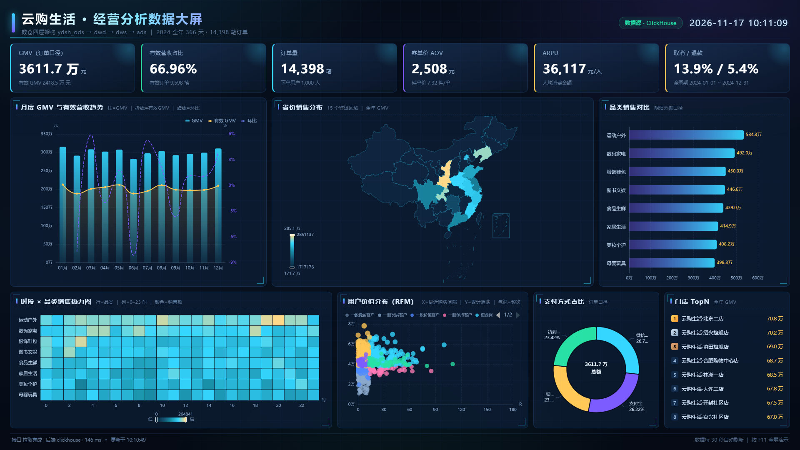
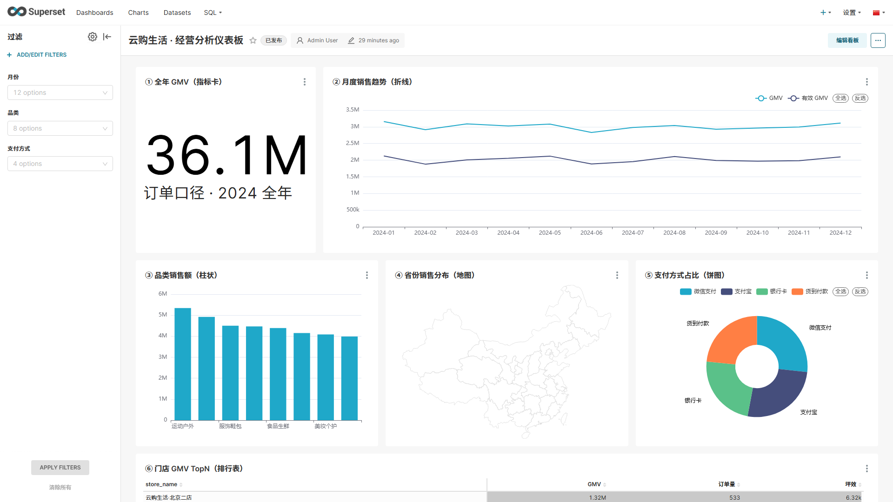
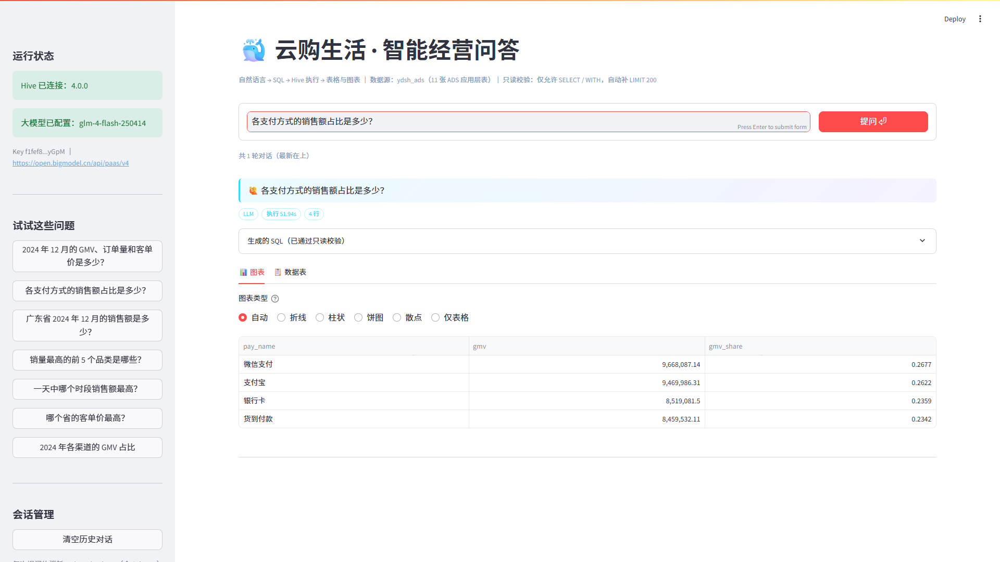

# 云购生活 · 部署手册

| 项目 | 内容 |
|---|---|
| 项目名称 | 云购生活新零售企业 · 企业级数据仓库与经营分析可视化系统 |
| 团队 / 作者 | 乐天（余天乐，20230308098） |
| 文档版本 | v5.0（项目级：从 ODS 装载到三端验收的全流程部署） |
| 编写日期 | 2026-11-23 |
| 适用环境 | Windows 10/11 + Docker Desktop（WSL2 后端），本手册命令与输出均来自真机实测 |
| 前序版本 | 第 4 周《第4周_部署手册》（只覆盖第 4 周可视化与容器启动） |
| 配套文件 | `docker-compose.yml`、`.env.example`、`第1周/`～`第5周/`、`第5周/py/e2e_verify.py` |

---

## 一、这套系统由什么组成

### 1.1 服务清单：9 个（7 个常驻 + 2 个一次性任务）

| 服务 | 容器名 | 端口 | 作用 | 健康检查 |
|---|---|---|---|---|
| mysql | mysql | 3307→3306 | Hive Metastore 元数据库 + Superset 元数据 + 业务库快照 | `mysqladmin ping` |
| mysql-init | mysql-init | — | 一次性建库（`superset_meta` / `ydsh_mysql` + 只读账号 `ydsh_ro`），跑完退出 | 退出码 0 |
| hive-metastore | hive-metastore | 9083 | Hive 元数据服务 | 9083 端口可连 |
| hive-server | hive-server | 10000 / 10002 | HiveServer2，数仓主数据源（4 个库 51 张表） | 10000 端口可连 |
| clickhouse | clickhouse | 8123 / 9000 | 服务层缓存（ADS 11 张结果集副本） | `select 1` |
| superset | superset | 8088 | BI 仪表板（6 图表 + 3 筛选器 + 交叉联动） | HTTP `/health` |
| superset-init | superset-init | — | 一次性建数据源/数据集/6 图表/仪表板，跑完退出 | 退出码 0 |
| api | ydsh-api | 8000 | 10 个 JSON 接口 + 托管 ECharts 大屏 | HTTP `/api/health` |
| app | ydsh-app | 8501 | Streamlit 对话式问答（NL2SQL） | HTTP `/_stcore/health` |

> **口径统一**：第 4 周部分文档写"8 个服务"，是漏算了 `mysql-init`。按 `docker-compose.yml` 实际是 **9 个**，第 5 周起所有文档统一为"9 个服务（7 个常驻 + 2 个一次性初始化任务）"。

### 1.2 访问入口

| 入口 | 地址 | 账号 | 截图 |
|---|---|---|---|
| ECharts 数据大屏 | http://localhost:8000/ | 免登录 | 见下方图一 |
| Superset 仪表板 | http://localhost:8088/superset/dashboard/ydgmv-overview/ | admin / admin | 见下方图二 |
| Streamlit 问答 | http://localhost:8501/ | 免登录 | 见下方图三 |
| 数据服务接口文档 | http://localhost:8000/api/docs | 免登录 | — |
| 服务健康检查 | http://localhost:8000/api/health | 免登录 | — |







### 1.3 启动顺序（由 `depends_on` + `healthcheck` 保证）

```
mysql(healthy) ─→ mysql-init(完成) ─→ superset(healthy) ─→ superset-init(完成)
   │
   └─→ hive-metastore(healthy) ─→ hive-server(healthy) ─┬─→ api ─→ app
                                                        └─→ clickhouse(healthy)
```

顺序不是"写着好看"：Hive 冷启动要 60～120 秒，如果 Superset 抢跑，会在元数据库还没建表时去连 Hive，直接进入重启循环。用 healthcheck 从机制上避免，而不是靠"多等一会儿"。

### 1.4 目录约定

```
xiangmushixun-bde/
├── docker-compose.yml        # 9 个服务的编排（本手册主角）
├── .env.example              # 环境变量模板（复制成 .env 后填值）
├── .env                      # 真实密钥，.gitignore 已排除，绝不提交
├── data/csv/                 # 6 个 ODS 源 CSV（容器内挂到 /data）
├── data/mysql/               # MySQL 持久化（bind mount，down -v 不丢）
├── data/warehouse/           # Hive 数仓存储（bind mount，down -v 不丢）
├── lib/                      # mysql-connector-j-8.0.33.jar
├── 第1周/  …  第5周/          # 各周资产，只读挂载进 hive-server（/repo/第N周）
└── README.md / README.en.md
```

容器内路径规律：宿主机 `第N周/sql/x.sql` → 容器内 `/repo/第N周/sql/x.sql`（第 1～5 周都已挂载）。

---

## 二、环境要求

| 项 | 要求 | 本机实测 |
|---|---|---|
| 操作系统 | Windows 10/11 + WSL2 | Windows 11 |
| Docker | Docker Desktop，含 Compose v2 | 引擎 29.9.2 |
| 内存 | ≥ 8 GB（Hive + Superset + CH 同时跑） | 占用约 5.2 GB |
| 磁盘 | ≥ 10 GB（镜像约 1.6 GB + 数据卷） | — |
| 端口 | 3307、9083、10000、10002、8123、9000、8088、8000、8501 未被占用 | 已核对 |
| 网络 | 首次构建需拉 pip 包（已配清华源）；运行时除 LLM 外可完全离线 | — |
| 宿主机 Python（可选） | 仅用于跑校验/导出/自检脚本，版本 3.12 | 3.12.14 |

端口占用自查：

```powershell
netstat -ano | findstr "3307 9083 10000 8123 8088 8000 8501"
```

宿主机 Python 依赖（只在跑脚本时需要，容器内已单独安装）：

```powershell
python -m pip install -i https://pypi.tuna.tsinghua.edu.cn/simple `
  pandas pyhive thrift thrift_sasl pure-sasl sqlalchemy pymysql `
  clickhouse-connect requests python-dotenv python-docx openpyxl websockets
```

> **pyhive 连 Hive 的两个硬性条件**：`auth="NONE"`；必须同时装 `thrift_sasl` 与 `pure-sasl`，少一个就报 `No module named 'thrift_sasl'` 或 `TSocket read 0 bytes`。

---

## 三、首次部署（从零到三端可看，8～12 分钟）

### 步骤 1：准备代码与数据

```powershell
cd D:\xiangmushixun-bde
git status                     # 确认工作区干净
dir data\csv                   # 应有 6 个 CSV
```

6 个 CSV：`user.csv`、`product.csv`、`store.csv`、`order.csv`、`order_item.csv`、`user_behavior.csv`（合计 114,809 行）。

### 步骤 2：生成 `.env`

```powershell
Copy-Item .env.example .env
```

最少要填三项：

| 变量 | 说明 | 不填的后果 |
|---|---|---|
| `SUPERSET_SECRET_KEY` | 会话签名密钥，必须随机 | Superset 拒绝启动（官方镜像有安全检查） |
| `LLM_API_KEY` | 大模型 Key；留空则问答进演示模式 | NL2SQL 无法调模型 |
| `CLICKHOUSE_PASSWORD` | ClickHouse 密码 | 用默认值也能跑，但不建议 |

生成随机密钥：

```powershell
docker run --rm python:3.12-slim python -c "import secrets;print(secrets.token_urlsafe(42))"
```

### 步骤 3：构建镜像

```powershell
docker compose build
```

会构建两个镜像：

- `ydsh/superset:4.1.2`：官方 Superset + PyHive/thrift/pure-sasl/PyMySQL 驱动 + 自定义配置（约 950 MB）
- `ydsh/app:4.0`：Python 3.12 + FastAPI/Streamlit/LangChain/PyHive（约 620 MB）

首次 3～6 分钟；之后改代码只重建上层，约 10 秒。

### 步骤 4：一键启动 9 个服务

```powershell
docker compose up -d
docker compose ps
```

期望：**7 个 `Up (healthy)` + 2 个 `Exited (0)`**（`mysql-init`、`superset-init` 是一次性任务，退出即完成）。

### 步骤 5：修中文注释（仅在换新机器时做一次）

Hive 官方 metastore schema 把注释列定义成 `latin1`，中文 `comment` 会被 MySQL **静默替换成 `?`**（不报错，建表看似成功）。新环境需执行 6 条 `ALTER TABLE`（完整语句见 `第1周/docs/环境搭建笔记.md` 第六节）：

```powershell
docker exec -i mysql mysql -uroot -proot metastore -e "
ALTER TABLE COLUMNS_V2 MODIFY COLUMN COMMENT varchar(4000) CHARACTER SET utf8mb4;
ALTER TABLE TABLE_PARAMS MODIFY COLUMN PARAM_VALUE varchar(4000) CHARACTER SET utf8mb4;
ALTER TABLE PARTITION_PARAMS MODIFY COLUMN PARAM_VALUE varchar(4000) CHARACTER SET utf8mb4;
ALTER TABLE PARTITION_KEYS MODIFY COLUMN PKEY_COMMENT varchar(4000) CHARACTER SET utf8mb4;
ALTER TABLE INDEX_PARAMS MODIFY COLUMN PARAM_VALUE varchar(4000) CHARACTER SET utf8mb4;
ALTER TABLE TBLS MODIFY COLUMN TBL_COMMENT varchar(4000) CHARACTER SET utf8mb4;"
```

验证：随便 `describe formatted` 一张表，能看到中文注释而不是 `?`。

### 步骤 6：装载数仓（ODS → DWD → DWS → ADS）

**这一步是"数据"和"代码"的分界**：镜像只带代码，数据在 `data/warehouse` 里。若数据目录已随仓库/备份带过来，本节可跳过，只做"步骤 7 的副本同步"。全新环境按下表顺序执行（全部在宿主机 PowerShell 里跑，每行约 0.5～4 分钟）。

**① 第 1 周：ODS 贴源层（6 张表）**

```powershell
docker exec hive-server beeline -u jdbc:hive2://localhost:10000 -f /repo/第1周/sql/ods/create_ods.sql
docker exec hive-server beeline -u jdbc:hive2://localhost:10000 -f /repo/第1周/sql/ods/load_ods.sql
```

期望：6 张表，合计 **114,809** 行。

**② 第 2 周：清洗 + DWD 明细层（25 张表）**

```powershell
docker exec hive-server beeline -u jdbc:hive2://localhost:10000 -f /repo/第2周/sql/clean/clean_missing.sql
docker exec hive-server beeline -u jdbc:hive2://localhost:10000 -f /repo/第2周/sql/clean/clean_duplicate.sql
docker exec hive-server beeline -u jdbc:hive2://localhost:10000 -f /repo/第2周/sql/clean/clean_enum.sql
docker exec hive-server beeline -u jdbc:hive2://localhost:10000 -f /repo/第2周/sql/clean/clean_format.sql
docker exec hive-server beeline -u jdbc:hive2://localhost:10000 -f /repo/第2周/sql/clean/clean_split_merge.sql
docker exec hive-server beeline -u jdbc:hive2://localhost:10000 -f /repo/第2周/sql/dwd/create_dwd.sql
docker exec hive-server beeline -u jdbc:hive2://localhost:10000 -f /repo/第2周/sql/dwd/load_dwd.sql
docker exec hive-server beeline -u jdbc:hive2://localhost:10000 -f /repo/第2周/sql/dwd/verify_dwd.sql
```

期望：清洗后 6 条主链路合计 **111,037** 行（剔除 3,772 行，3.29%）；`dwd_order` 12 个分区、8 个桶；孤儿外键 0。

实测参考：`create_dwd.sql` 约 11～14 秒，`load_dwd.sql` 约 215～222 秒。

**③ 第 3 周：DWS 汇总层（9 张）+ ADS 应用层（9 张）**

```powershell
docker exec hive-server beeline -u jdbc:hive2://localhost:10000 -f /repo/第3周/sql/dws/create_dws.sql
docker exec hive-server beeline -u jdbc:hive2://localhost:10000 -f /repo/第3周/sql/dws/load_dws.sql
docker exec hive-server beeline -u jdbc:hive2://localhost:10000 -f /repo/第3周/sql/dws/verify_dws.sql

docker exec hive-server beeline -u jdbc:hive2://localhost:10000 -f /repo/第3周/sql/ads/create_ads.sql
docker exec hive-server beeline -u jdbc:hive2://localhost:10000 -f /repo/第3周/sql/ads/load_ads.sql
docker exec hive-server beeline -u jdbc:hive2://localhost:10000 -f /repo/第3周/sql/ads/verify_ads.sql
```

期望：DWS 9 张（合计约 25,500 行），ADS 9 张；`ads_kpi_overview.gmv = 36,116,687.06`。

**④ 第 4 周：新增 2 张 ADS 表（支付方式、时段×品类）**

在宿主机跑（脚本走 pyhive，不依赖容器内 beeline）：

```powershell
cd 第4周/py
python sql_runner.py ../sql/ads/create_ads_w4.sql --out ../evidence/ads_w4_create.txt
python sql_runner.py ../sql/ads/load_ads_w4.sql   --out ../evidence/ads_w4_load.txt
python sql_runner.py ../sql/ads/verify_ads_w4.sql --out ../evidence/ads_w4_verify.txt
```

期望：`verify_ads_w4.txt` 末尾 `失败 0 条`；支付表 GMV 合计 36,116,687.06，热力表销售额合计 35,833,305.06。

> 也可以双击 `第4周/一键运行/1_初始化可视化数据.bat`（等价于上面 3 条 + 下面步骤 7 的两条）。

### 步骤 7：同步服务层副本（ClickHouse + MySQL）

```powershell
cd 第4周/py
python export_to_clickhouse.py     # ADS 11 张 → CH，自带 11 表一致性校验
python export_to_mysql.py          # KPI 快照 3 张 → MySQL（61 行）
```

期望：`export_to_clickhouse.py` 输出 11 行 PASS；MySQL `ydsh_mysql` 3 张表共 61 行。

### 步骤 8：三端验收 + 端到端自检

```powershell
cd 第5周/py
python e2e_verify.py               # 39 项核对，约 150 秒
```

期望输出结尾：

```
核对项 39 个：通过 39，未通过 0
结论：全链路一致，端到端可复现
```

再逐个打开浏览器确认三个入口（见 1.2 表格）。SP 可用 `python 第4周/py/ui_check.py` 做无头浏览器自动点击 + 截图。

---

## 四、现场演示流程（答辩用，约 3 分钟）

1. **停干净**（演示"从零启动"）：

```powershell
docker compose down            # 注意：不要加 -v，加了会删 CH 命名卷
```

2. **一条命令拉起**：

```powershell
docker compose up -d
docker compose ps              # 边等边解释 9 个服务的依赖关系
```

3. **数据服务自检**：http://localhost:8000/api/health —— 展示 Hive 版本、ClickHouse 版本、当前后端 `backend`、各表行数。

4. **ECharts 大屏**：http://localhost:8000/（F11 全屏），说明 1920×1080 设计稿 + `scale()` 自适应、断网走 `snapshot.json` 兜底。

5. **Superset 仪表板**：http://localhost:8088（admin/admin），演示"月份 / 品类 / 支付方式"三个筛选器与交叉联动。

6. **Streamlit 问答**：http://localhost:8501，输入"各支付方式的销售额占比是多少？"，展示 SQL → 表格 → 图表。

7. **收尾**：说明密钥全部走 `.env`，`git status` 里看不到 `.env`；`docker compose ps` 两个 `Exited(0)` 是一次性任务不是失败。

---

## 五、日常运维命令

| 操作 | 命令 |
|---|---|
| 查看全部状态 | `docker compose ps` |
| 看某服务日志 | `docker compose logs -f --tail 100 superset` |
| 重启单个服务 | `docker compose restart api` |
| 改代码后重建重启 | `docker compose build api; docker compose up -d api` |
| 重新初始化仪表板 | `docker compose run --rm superset-init` |
| 全量校验 Superset 6 图表 | `docker compose run --rm --entrypoint python superset-init /app/check_superset.py` |
| 停止（保留数据） | `docker compose down` |
| 停止并删数据卷 | `docker compose down -v`（慎用，CH 副本需重跑导出） |
| 只重跑副本 | `python 第4周/py/export_to_clickhouse.py; python 第4周/py/export_to_mysql.py` |
| 项目级联调自检 | `python 第5周/py/e2e_verify.py` |
| 逐层核对（纯 SQL，容器内跑） | `docker exec hive-server beeline -u jdbc:hive2://localhost:10000 -f /repo/第5周/sql/integrity_check.sql` |

---

## 六、常见问题（全部为本项目真实踩过）

### 6.1 `hive-server` 反复 Restarting，日志是 `HiveServer2 running as process 7. Stop it first.`

原因：容器内 pid 文件残留（`docker restart hive-server` 会触发，冷启动被强杀也会）。
处理：

```powershell
docker compose up -d --force-recreate hive-server
```

**数据在 bind mount，不会丢。**（2026-11-19、2026-11-23 各踩过一次）

### 6.2 Superset 报 `Refusing to start due to insecure SECRET_KEY`

原因：没设置 `SUPERSET_SECRET_KEY`。处理：`.env` 填随机串，`docker compose up -d superset`。

### 6.3 建 Hive 数据源报 422，日志是 `cannot recognize input near 'SHOW' 'CATALOGS'`

原因：Superset 的 Hive 引擎规格继承 Presto，建数据源时执行 `SHOW CATALOGS`，Hive 4.0.0 不认。
处理：已在 `第4周/docker/superset/superset_config.py` 用 `FLASK_APP_MUTATOR` 关闭目录探测。日志出现下面这行即生效：

```
[superset_config] Hive 目录探测已关闭（app context 内生效）
```

### 6.4 Superset 写操作报 `The CSRF token is missing`

GET 用 JWT 够；POST/PUT 必须带 `X-CSRFToken`（先 GET `/api/v1/security/csrf_token/`）。

### 6.5 `superset fab create-admin` 卡在 `Username [admin]:`

原因：写在 `/bin/sh -c "多行"` 里会被拆散，命令退化成交互模式。
处理：改用 `第4周/docker/superset/create_admin.py`（app context 内调 FAB，幂等）。

### 6.6 仪表板 6 个位置都显示"没有找到相关图表的组件"

原因：REST API 建仪表板时 `slices` 字段不被接受，`dashboard_slices` 关联表为空。
处理：`bootstrap.py` 用模型层写关联（`link_dashboard_charts`），日志出现 `已关联 6 个图表到仪表板 1` 即正常。

### 6.7 图表建好但取数报 `Chart has no query context saved`

Superset 4.x 的图表有 `query_context` 快照，纯 API 建图不会自动写。处理：建图时一并写入。

### 6.8 ClickHouse 插入报 `filesystem error: in rename: Permission denied`

Windows 下不能用 bind mount 挂 `/var/lib/clickhouse`，CH 无法 rename 分区目录。已改为命名卷 `ydsh_clickhouse_data`。

### 6.9 Superset 报 `Unknown database 'superset_meta'`

MySQL 只建了一个库。已加 `mysql-init` 一次性服务建 `superset_meta` + `ydsh_mysql` + 只读账号。

### 6.10 端口被占用：`bind: Only one usage of each socket address`

本机已有进程占用 8000/8501（例如手工 `python api_server.py`）。处理：`Get-Process python | Stop-Process`，或改端口映射。

### 6.11 Hive 查询很慢（第一条 20 秒以上）

不是故障：Hive on Tez 每次提交都要起会话、编译执行计划。项目里做了三层缓解：ADS 预聚合、ClickHouse 副本、接口 10 秒 TTL 缓存。

### 6.12 分区裁剪失效：`where substr(order_date,1,7)='2024-11'` 比全表还慢

必须用分区列本身：`where order_month='2024-11'`（15.44 s → 2.58 s）。写 `substr` 会让 Hive 放弃裁剪。

### 6.13 `Too many counters: 121 max=120`

单条 SQL 的 `union all` 分支超过 8 路会超 Tez 计数器上限。拆分语句，一条语句尽量一张表。

### 6.14 中文别名报错 `cannot recognize input near 'as'`

Hive 里中文别名必须加反引号：`` as `统计栏名` ``。

### 6.15 金额出现 `28757.559999999998`

Hive `double` 求和不做四舍五入，必须 `round(sum(...), 2)`。

### 6.16 `docker compose down -v` 之后 CH 数据没了

`-v` 删除命名卷 `ydsh_clickhouse_data`。`data/mysql`、`data/warehouse` 是 bind mount 不受影响；CH 副本重跑 `export_to_clickhouse.py` 即可恢复。

### 6.17 PowerShell 里中文乱码 / 重定向输出变成 UTF-16

```powershell
[Console]::OutputEncoding=[Text.Encoding]::UTF8
$env:PYTHONIOENCODING="utf-8"
```

写文件用 `[IO.File]::WriteAllText($p, $s, (New-Object Text.UTF8Encoding($false)))`，不要用 `>`。

### 6.18 跑端到端自检报 `516 Authentication failed`（ClickHouse）

原因：`ch_client` 在 import 时读环境变量，脚本没先加载 `.env`，用 `default` + 空密码去连。
处理：第 5 周的 `e2e_verify.py` 已在入口处 `load_dotenv(仓库根/.env)`。手工跑其他脚本时同样要保证 `CLICKHOUSE_USER/CLICKHOUSE_PASSWORD` 已注入环境。

### 6.19 换机器后"表在、数没了"

`data/warehouse` 没随仓库带过来。按"步骤 6"重跑 ODS→ADS，再跑"步骤 7"重建两份副本。

### 6.20 系统 Python 是 3.8，装不上 pyhive 新版

本机 3.8.5 是零依赖系统 Python，不可用。请指定 3.12 解释器（本机为 `C:\Users\y\.dsh\dsh-runtimes\dsh-primary-runtime\dependencies\python\python.exe`）或自建虚拟环境。

---

## 七、部署验收清单（第 5 周最终版）

| # | 检查项 | 命令 / 地址 | 期望 |
|---|---|---|---|
| 1 | 9 个服务状态 | `docker compose ps` | 7 个 `Up (healthy)` + 2 个 `Exited (0)` |
| 2 | Hive 版本 | `/api/health` | `4.0.0` |
| 3 | ClickHouse 版本 | `/api/health` | `24.8.14.39` |
| 4 | 数据服务后端 | `/api/health` | `"backend": "clickhouse"` |
| 5 | 51 张表 | `python 第5周/py/e2e_verify.py` | ODS 6 / DWD 25 / DWS 9 / ADS 11 |
| 6 | 四层行数 | 同上 第 2～5 节 | 114,809 → 111,037 → ADS 2,666 |
| 7 | 核心指标 | 同上 第 5.1 节 | GMV 36,116,687.06、订单 14,398、AOV 2,508.45 |
| 8 | 口径闭合 | 同上 第 5.2 节 | 6 张订单口径 + 2 张分摊口径全部相等 |
| 9 | CH 副本一致性 | 同上 第 6 节 | 11/11 行数相等 |
| 10 | MySQL 快照 | 同上 第 6 节 | 3 张表 61 行 |
| 11 | 10 个接口 | 同上 第 7 节 | 10/10 返回 200 |
| 12 | Superset / Streamlit | 同上 第 7 节 | 均 200 |
| 13 | 仪表板联动 | 打开仪表板切换"月份" | 折线/柱状/省份条形/饼图/表同步变化 |
| 14 | 大屏渲染 | http://localhost:8000/?debug=1 | 7 个面板、无重叠、无空图 |
| 15 | 问答闭环 | 提问"各支付方式的销售额占比" | 出现 SQL、表格、图表三区块 |
| 16 | 密钥不入库 | `git status` / `git grep "sk-"` | 看不到 `.env`，无明文 Key |

一键跑完 1～12 项：

```powershell
python 第5周/py/e2e_verify.py
```